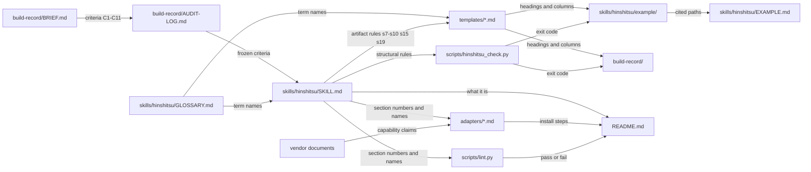

# CONNECTIONS — dependency graph for the hinshitsu build

An edge `A -->|label| B` means B depends on A: a change to A can break B. Before changing a node, trace forward (every node it points to), backward (every node that points to it) and lateral (nodes that share a provider with it).

## Edge list

| From | To | Label | Broken when |
|---|---|---|---|
| BRIEF.md | AUDIT-LOG.md | criteria | a criterion has no source line in the brief or a user message |
| AUDIT-LOG.md | SKILL.md | frozen criteria | a section lacks an element C2 or C11 lists |
| GLOSSARY.md | SKILL.md, templates, adapters, example | term names | a capitalized term is used and not defined, or defined twice |
| SKILL.md | adapters, lint.py | section numbers and names | a reference names a section number or title that `SKILL.md` does not have |
| SKILL.md | templates, hinshitsu_check.py | artifact rules | a template or check disagrees with the rule text |
| vendor documents | adapters | capability claims | a link fails or the page no longer says it |
| templates | example, build-record | headings and columns | an artifact lacks a template heading or column |
| hinshitsu_check.py | example, build-record | exit code | the script exits non-zero |
| example/ | EXAMPLE.md | cited paths | a cited path does not exist |
| SKILL.md, adapters, lint.py | README.md | summary and install steps | README states a step or rule the source does not |
