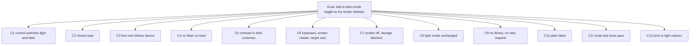
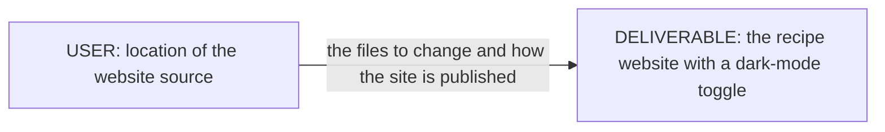

devin-61272d260949486c84d9c887b1582d9c

# Files written

All paths are under `/home/ubuntu/scratch/dark-mode/`. `GAUGE.svg` was written by the gauge script, not by hand. `tools/s3s4.py` and `tools/card.py` are the helper scripts that appended the log entries and rewrote the record files.

## `/home/ubuntu/scratch/dark-mode/hinshitsu/prompts/capability-probe.md`

`````markdown
State the task the user gave the orchestrator. If you have no record of it, reply NO RECORD.
`````

## `/home/ubuntu/scratch/dark-mode/hinshitsu/AUDIT-LOG.md`

`````markdown
# AUDIT-LOG — dark-mode toggle for the USER's recipe website

Append-only.

### E-1 · 2026-11-18T18:41:28Z · CAPABILITY · orchestrator

- Runtime and surface: Devin, web app (the orchestrator is Devin session devin-61272d260949486c84d9c887b1582d9c, started through the API by a parent session; each SUB-AGENT is a child Devin session)
- RUN FOLDER: `/home/ubuntu/scratch/dark-mode/hinshitsu/` (a scratch folder outside the repository, as the task orders; not the default)
- Tool that starts a SUB-AGENT: `devin_session_create`
- SWARM-CAPABLE part 1 (the orchestrator writes the whole scope): no — not used yet in this run (rule 0.4); the probe is its first use
- SWARM-CAPABLE part 2 (the sub-agent starts without the builder's conversation): no — not tested yet; the probe under rule 0.2 follows this entry
- SWARM-CAPABLE part 3 (the report returns whole and is saved word for word): no — not used yet in this run (rule 0.4)
- SWARM-CAPABLE part 4 (the runtime gives each sub-agent run an identifier): no — not tested yet
- SWARM-CAPABLE part 5 (a test call in this run started a sub-agent): no — not made yet
- Write files: yes. Run commands: yes. Use git: no — not used on the RUN FOLDER, which is not a git repository. Open a browser: no — not used yet. Take screenshots: no — not used yet. Read a clock: yes (`date -u`).
- Mode: not set — the probe decides it; a second CAPABILITY entry will record the result
- SUB-AGENT runs the TIER requires: not counted — the TIER entry does not exist yet, and no file of the USER's website is available to measure
- Order: rule 0.1 puts this entry before any other action, rule 0.4 forbids `yes` before a use, and rule 1.5 puts a LAUNCH entry before the probe. This entry therefore states `no` for each untested part and a later CAPABILITY entry states the result.
- Actions taken before this entry: read `skills/hinshitsu/SKILL.md`, `GLOSSARY.md`, `skills/hinshitsu-gauge/SKILL.md`, `adapters/devin.md`, the head of the example run's `AUDIT-LOG.md` and its probe files (to learn the entry form and the tool name), searched the tool list, and created this folder.

### E-2 · 2026-11-18T18:41:28Z · STAGE · orchestrator

- Stage: S1
- Event: start
- Skill read: `skills/hinshitsu/SKILL.md`, 12763 bytes, SHA-256 78c89615fddec96ee77ed1141fb8276737d3464213012600df3d823fae1a974c

### E-3 · 2026-11-18T18:41:28Z · LAUNCH · orchestrator

- Role: capability probe (rule 0.2); no file under `templates/roles/` exists for it
- Scope: `prompts/capability-probe.md`, the sentence of rule 0.2 word for word
- Commit under review: no git
- SUB-AGENT run identifier: devin-3b4454add4a34cbfa3a3b4baa0cb47f8

### E-4 · 2026-11-18T18:44:07Z · CAPABILITY · orchestrator

- Probe result: child session devin-3b4454add4a34cbfa3a3b4baa0cb47f8 (https://app.devin.ai/sessions/3b4454add4a34cbfa3a3b4baa0cb47f8), launched by E-3, replied `NO RECORD` 5 seconds after its start: `evidence/capability-probe.md`
- SWARM-CAPABLE part 1: yes — the child session's prompt was `prompts/capability-probe.md`, passed by path
- SWARM-CAPABLE part 2: yes — the reply is `NO RECORD`
- SWARM-CAPABLE part 3: yes — the reply was read with `devin_session_interact` (action `get_messages`) and saved whole; the first line of the saved file is the runtime's identifier, which the ORCHESTRATOR added under rule 1.6
- SWARM-CAPABLE part 4: yes — the runtime returned session ID 3b4454add4a34cbfa3a3b4baa0cb47f8
- SWARM-CAPABLE part 5: yes — the probe above
- Write files: yes. Run commands: yes. Use git: no — the RUN FOLDER has no git, not used. Open a browser: no — not used yet. Take screenshots: no — not used yet. Read a clock: yes.
- Mode: SWARM
- SUB-AGENT runs the TIER requires: rule 0.5 gives no number for `FULL`. Count from the role lists the conductor names for 1 WORK UNIT: 4 LENS, 2 RED CELL attacks, 8 AUDITOR roles of section 13, 1 final AUDITOR = 15, plus 1 re-audit for each FINDING fixed. Sections 5, 6, 13 and 17 are not read yet; the count is restated when they are.

### E-5 · 2026-11-18T18:44:07Z · TIER · orchestrator

- Change measured: none. No git diff, file count or line count exists: the USER's recipe website is not in this workspace. Searches: `gh repo list CatCorner22 --limit 100` shows no repository named for recipes; `grep -rIl -i recipe` over `/home/ubuntu/repos` found 2 files, both knowledge notes in Dental-Mgmt.
- Section-18 action in the change: not known — section 18 is not read yet (S2)
- TIER: FULL. Rule 0.5 gives `CORE` only when the numbers show at most 3 files and 100 lines; with no numbers the change is "every other change". This entry is rewritten as a new TIER entry when the website's files are available.

### E-6 · 2026-11-18T18:44:07Z · STAGE · orchestrator

- Stage: S1
- Event: end
- Artifacts: `AUDIT-LOG.md`, `prompts/capability-probe.md`, `evidence/capability-probe.md`

### E-7 · 2026-11-18T18:44:48Z · CORRECTION · orchestrator

- Corrects: E-3
- What happened: after the probe returned, the ORCHESTRATOR replaced the last line of E-3 in place (`sed -i`), changing "pending — see the next CAPABILITY entry" to the identifier devin-3b4454add4a34cbfa3a3b4baa0cb47f8. Rule 9.6 forbids editing an entry. The ORCHESTRATOR had not read section 9 at that time, because the conductor names `hinshitsu-record` for S2 and the edit happened in S1.
- Effect: the identifier in E-3 is true and E-4 states it also. The folder has no git, so no history shows the first wording; this entry is the only record of it.
- Written late: yes.

### E-8 · 2026-11-18T18:44:48Z · ROLLBACK · orchestrator

- Action: started child Devin session devin-3b4454add4a34cbfa3a3b4baa0cb47f8 for the probe of rule 0.2. A child session draws on the USER's Devin usage, which rule 18.1 covers as "spending money".
- Undo: none — usage consumed is not returned. The session reports `acus_consumed: 0.0` at 2026-11-18T18:44:48Z; it is idle and can be ended with `devin_session_interact` (action `terminate`).
- Undo tested: no.
- Written late: yes (rule 18.4). Rule 0.2 orders the probe in S1; section 18 is read in S2. The USER is told in the next message.
- Standing effect: every later SUB-AGENT run is a covered action with no undo. Under rule 18.3 the ORCHESTRATOR starts none until the USER approves that named action on a DECISION CARD.

### E-9 · 2026-11-18T18:44:48Z · STAGE · orchestrator

- Stage: S2
- Event: start
- Skill read: `skills/hinshitsu-record/SKILL.md`, 10880 bytes, SHA-256 3f72e339ca0fac2227b63bf5a9d3598f2e5069029482d21e01ffd6e3884ff777

### E-10 · 2026-11-18T18:44:48Z · STAGE · orchestrator

- Stage: S2
- Event: end
- Artifacts: `FRAMEWORK.md`, `CONNECTIONS.md`, `SESSION-STATE.md`, `MINDMAP.md`, `COVERAGE-LEDGER.md`, `GAUGE.svg`
- Existing-implementation search (rule 7.5): recorded in part 7 of `FRAMEWORK.md`; the website was not found.

### E-11 · 2026-11-18T18:46:31Z · STAGE · orchestrator

- Stage: S3
- Event: start
- Skill read: `skills/hinshitsu-baby-bird-plan/SKILL.md`, 10655 bytes, SHA-256 0017aa800bb70df079ca9f0271d3a1bcbef3b2a15d86de5cdd49dfba5e2f0a65

### E-12 · 2026-11-18T18:46:31Z · VOC · orchestrator

**RECIPIENTS**
1. The USER (GitHub account CatCorner22), who owns the recipe website. The USER will receive the changed website files and publish them. Device and tool: not known (VA1).
2. Each visitor of the recipe website, who reads recipes and will use the toggle. Device: not known (VA2).

**Verbatim needs**
- V1: "Add a dark-mode toggle to my recipe website." — the task message of this session (message `event-01a1eff5a6da7a0a90c8f91749020142`), which relays it as "Task from the user".

**Observed-workflow needs**
- O1: the USER's standing instruction for all user-facing text: "streamline it to the absolute greatest extent possible without sacrificing content quality" — simple words, short sentences, active voice. Record: `~/memory/blakereaganlaw_7eb639/MEMORY.md`, entry marked confidence high.
- Where the ORCHESTRATOR looked: the task message; `MEMORY.md` and the list of memory files (no file on a recipe website); `gh repo list CatCorner22 --limit 100` (no recipe repository); `grep -rIl -i recipe` over the 5 checkouts in `/home/ubuntu/repos` (2 unrelated notes). No repository history, earlier deliverable or earlier message about a recipe website was found.

**Translation**

| Customer language | Technical requirement | CRITERION ID |
|---|---|---|
| "Add a dark-mode toggle" (V1) | 1 control on every page switches the page between a light and a dark colour scheme; the choice is kept; the page is readable in both | C1, C2, C3, C4, C5, C6, C7, C12 |
| "to my recipe website" (V1) | the change is made to the existing website and leaves what exists working | C8, C9, C11 |
| "streamline it to the absolute greatest extent possible without sacrificing content quality" (O1) | the words on the control are short and plain | C10 |

**VOC-ASSUMED**
- VA1: the USER receives the change as files or a branch and publishes it. Guess: yes.
- VA2: visitors use phones and desktop browsers. Guess: both, from 360 px width up.
- VA3: "dark-mode toggle" means a control the visitor presses, and not only a site that follows the device setting. Guess: a control.
- VA4: the visitor wants the choice kept for the next visit. Guess: yes.
- VA5: "my recipe website" is a website the USER can change at the source, and not a page on a hosted builder that allows no code. Guess: source the USER can give.
- VA6: the website has no dark colours today. Guess: none.

### E-13 · 2026-11-18T18:46:31Z · GAP · orchestrator

Each line: gap or `no gap` · recommended answer · reason in plain words · cost · who decides · state.

| ID | Subject | Gap | Recommended answer | Reason | Cost | Decides | State |
|---|---|---|---|---|---|---|---|
| G1 | What happens on error | The browser can refuse to store the choice (private browsing, storage turned off). | The toggle still works for the page in view; the next page follows the device setting; no error shows. | A visitor who blocks storage still reads recipes. | about 5 lines of code | AGENT | Assumed |
| G2 | Empty, huge and invalid input | The toggle takes no typed input. A stored value that is not `light` or `dark` can exist. | Treat any other stored value as no choice. | An old or damaged value cannot lock a visitor into a broken page. | 1 line | AGENT | Assumed |
| G3 | Small screens and other devices | The request names no screen size, keyboard or screen reader. | The control fits and works at 360 px width, by keyboard, and with a screen reader; its target is at least 24 by 24 CSS pixels. | Recipe pages are read on phones in kitchens. | 2 extra checks in a browser | AGENT | Assumed |
| G4 | Who may use it and who must not | no gap — every visitor may use the toggle; it gives access to nothing. | — | — | none | — | no gap |
| G5 | Secrets and private data | The choice is a stored preference. | Store it only in the visitor's browser (local storage: a small note the browser keeps for 1 website). Send nothing to a server. | No account and no tracking are needed for a colour choice. | none | AGENT for the storage; USER for whether the site's privacy notice names it | Assumed; notice question goes on the criteria card |
| G6 | Backup and undo | The change touches files the run did not create. | Work on a copy; deliver a patch or branch; the undo is to drop the patch or revert the commit. | The live site stays as it is until the USER publishes. | none | AGENT | Assumed |
| G7 | Cost to run | no gap — plain CSS and a short script; no service, no library, no fee. | — | — | none | — | no gap |
| G8 | Upkeep and who maintains it | A page or part added later with fixed colours will look wrong in dark mode. | Put every colour in 1 list of named colours (CSS variables: names that stand for a colour so 1 change reaches every page) and state the rule in the report. | The USER maintains the site and needs 1 place to change. | size depends on how many fixed colours the site has | AGENT | Assumed |
| G9 | What the RECIPIENT sees when it breaks | With scripts off, a script-driven toggle does nothing. A late script shows a flash of the light page first. | With scripts off the page follows the device setting and the control is hidden; the choice is applied before the page first paints. | A dead button and a white flash at night are the 2 common faults of dark mode. | 1 short script in the page head | AGENT | Assumed |
| G10 | Licenses and legal terms | no gap in licenses — no third-party code is added. | — | — | none | — | no gap |
| G11 | How the RECIPIENT gets it and opens it | Not stated how the site is published, and the task forbids a push. | Deliver the changed files and a patch in the scratch folder with 1 command to apply it; the USER publishes. | The ORCHESTRATOR has no leave to publish or push. | none | USER | open — on the card |
| G12 | Where the website is | No repository, folder or address was given, and the searches in the VOC entry found none. | The USER names the repository or sends the files. | Nothing can be built or checked against a site that is not here. | 1 reply | USER | open — on the card |
| G13 | First visit | Not stated which colours a first-time visitor sees. | Follow the device's light or dark setting; the toggle overrides it. | The visitor already told the device what the visitor prefers. | none | USER (product behavior) | open — on the criteria card |
| G14 | Dark colours | Not stated which dark colours to use. | Derive them from the site's present colours; text contrast at least 4.5 to 1 (the WCAG AA reading level). | Keeps the site's look and stays readable. | 1 round of colour choices | USER (taste) | open — on the criteria card |
| G15 | Where the control sits and what it says | Not stated. | Top right of the header on every page; label "Dark mode" with an on/off state. | It is where visitors look for it. | none | USER (taste) | open — on the criteria card |
| G16 | Photos and logos | A logo with a transparent background can vanish on a dark page. | Leave photos as they are; check each logo and icon on the dark background and give it a light variant or a backing where it vanishes. | Food photos must keep true colour. | depends on the number of images | AGENT | Assumed |
| G17 | Printing | A dark page wastes ink. | Print always uses the light colours. | Recipes get printed. | about 5 lines of CSS | AGENT | Assumed |
| G18 | Cost of the checks | Each independent checker is a separate Devin session that draws on the USER's usage. | The USER approves the spend before any checker starts. | Spending belongs to the USER and cannot be undone. | 5 sessions for the plan review; about 10 more for each part built; 1 for each fix | USER (spending) | open — on the card |

### E-14 · 2026-11-18T18:46:31Z · STAGE · orchestrator

- Stage: S3
- Event: end
- Artifacts: `AUDIT-LOG.md` entries E-12 (VOC) and E-13 (GAP)

### E-15 · 2026-11-18T18:46:31Z · STAGE · orchestrator

- Stage: S4
- Event: start
- Skill read: `skills/hinshitsu-baby-bird-plan/SKILL.md`, 10655 bytes, SHA-256 0017aa800bb70df079ca9f0271d3a1bcbef3b2a15d86de5cdd49dfba5e2f0a65 (read whole at the start of S3, 1 tool call before this entry; not read a second time from the file)

### E-16 · 2026-11-18T18:46:31Z · ASSUMPTION · orchestrator

No `DECISION` entry exists yet. These PREMISES are the ones the PROPOSED CRITERIA and any later decision rest on.

| ID | PREMISE | Rests on it | EVIDENCE | If false |
|---|---|---|---|---|
| A-1 | The recipe website exists as source files that the USER can give the AGENT. | every CRITERION | not verified — searches in E-12 found no such source | nothing can be built; the task changes to building a site or to instructions for a hosted builder |
| A-2 | The pages share 1 stylesheet or 1 layout, so 1 control reaches every page. | C1, C2, C8 | not verified | each page needs its own change; the size and the TIER grow |
| A-3 | The website has no dark colours and no theme switch today. | C1, C8 | not verified | the work is to extend what exists, and a second switch would be a duplicate |
| A-4 | Visitors' browsers support CSS variables, the `prefers-color-scheme` media query and local storage. | C2, C3, C4 | not verified in this run — a public compatibility table can settle it; the ORCHESTRATOR did not open one before the stop | a fallback for old browsers is needed |
| A-5 | The USER, and not the AGENT, publishes the website. | G11, C11 | the task message: "Do not push to any repository." | a deploy step and a rollback entry are added |
| A-6 | The site's colours are set in CSS the AGENT can edit, and not inside images or a locked theme. | C5, C8 | not verified | dark mode needs new images or cannot reach parts of the page |
| A-7 | The USER accepts the cost of independent checker sessions. | S5, S7 to S10 | not verified — spending belongs to the USER | the run is checked by 1 agent only and is delivered as not fully checked |

- Verified by a command or file read: none of A-1 to A-4 or A-6 can be settled without the website's files; A-5 rests on the task message.
- Who received this list: nobody yet. No LENS and no RED CELL has started. A-1, A-5 and A-7 concern the USER's goal and money and go to the USER on the card that follows.

### E-17 · 2026-11-18T18:46:31Z · CRITERIA · orchestrator

- Status: PROPOSED
- Source: the Translation table in E-12 and the gaps marked `Assumed` in E-13. No CRITERION is approved. Page names, widths and commands that depend on the website's files are restated when the files are available.

| ID | The DELIVERABLE… | Test |
|---|---|---|
| C1 | shows 1 control in the header of every page that switches the page between light colours and dark colours on 1 click, tap, or press of Enter or Space. | Browser step by the correctness auditor on each page layout: press the control twice; a screenshot of each state saved under `evidence/`. |
| C2 | keeps the visitor's choice after a reload and on every other page, in the same browser. | Browser step: choose dark, reload, open 2 other pages; the stored value and 3 screenshots saved. |
| C3 | follows the device's light or dark setting on a visit with no stored choice. | Browser step with the device setting emulated as light, then dark, storage cleared; 2 screenshots. |
| C4 | applies the stored choice before the first paint, so no page shows the other colours first. | Recording of a load with the network slowed to "Slow 3G" and dark stored; no light frame appears; the correctness auditor also reads that the script runs in the page head before the body. |
| C5 | has, in both colour schemes, a contrast of at least 4.5 to 1 for text and 3 to 1 for large text and control outlines on every page layout. | Command: `npx @axe-core/cli <each page URL>` in each scheme reports 0 `color-contrast` violations; output saved. |
| C6 | lets a keyboard user and a screen-reader user find, operate and read the state of the control; the control is at least 24 by 24 CSS pixels at 360 px width. | Browser step by the recipient-experience auditor: Tab to the control, visible focus ring, name and pressed state read from the accessibility tree; measured size saved. |
| C7 | stays readable with scripts turned off and with storage blocked: the page follows the device setting, the control is hidden when scripts are off, and the console shows no error. | Browser step by the adversarial auditor in both conditions; screenshots and console output saved. |
| C8 | looks the same in light mode as before the change, apart from the control. | Command: screenshot each page layout at 360, 768 and 1280 px before and after; a pixel comparison shows differences only inside the control's box; images and comparison output saved. |
| C9 | adds no third-party library and makes no new network request. | Command: `git diff --stat` shows no change to a dependency file; the browser's network log before and after lists the same hosts. |
| C10 | labels the control in at most 3 plain words that say what it does. | Reading by the language auditor. |
| C11 | passes the website's own build and tests, where the website has them. | Command: the website's build and test commands, named when the files are available; full output saved. |
| C12 | prints in the light colours whichever scheme is chosen. | Browser step: print preview with dark chosen; screenshot saved. |

### E-18 · 2026-11-18T18:46:31Z · STAGE · orchestrator

- Stage: S4
- Event: end
- Artifacts: `AUDIT-LOG.md` entries E-16 (ASSUMPTION) and E-17 (CRITERIA, PROPOSED)

### E-19 · 2026-11-18T18:47:13Z · CARD · orchestrator

- Sent: after S4, before S5. S5 starts 5 SUB-AGENTS; each is a covered action with no undo (E-8), and no website exists to plan against (G12).
- Decisions open at this moment and on this card: G12 (where the website is) and G18 (spend on checkers). G11, G13, G14, G15 and the notice question of G5 wait for the criteria card at S6, as the skill orders.
- Working assumption while the card is open: the recommended answers — the USER names a repository; the USER approves checker sessions. Neither is acted on. No SUB-AGENT starts and no file of the website is written until an `ANSWER` entry quotes the USER.
- Work that no answer can change or waste: none found. S5 attacks a plan that does not exist without the website; S7 builds on files that are not here.
- Card, word for word (also saved as `evidence/card-1.md`):

**Decision 1 — Where is your recipe website?**
- Question: Which repository (the folder on GitHub that holds a site's code) or folder holds your recipe website?
- I recommend: name the GitHub repository, because I can then read your real pages and build the toggle on them.
- Your choices:
  - Name a repository: I build on your real pages. You give nothing up.
  - Send the files: same result. You upload them by hand.
  - Say no site exists yet: I plan a small new recipe site with the toggle. That is a bigger job.
- Reply with: "Repo: <name>", "Files attached", or "No site yet".

**Decision 2 — May I spend your Devin credits on independent checkers?**
- Question: May I start separate Devin sessions, which use your credits, to check the plan and the work?
- I recommend yes, because a checker that did not build the work finds faults the builder misses.
- Your choices:
  - Yes: sessions that never saw my work check every part. You spend credits on about 5 sessions for the plan, about 10 for each part I build, and 1 for each fix.
  - No: you spend nothing more. I check my own work in separate passes and mark the result "not fully checked".
- Reply with: "Checkers: yes" or "Checkers: no".

### E-20 · 2026-11-18T18:47:13Z · COMPACTION · orchestrator

- Reason: pause — the run stops to wait for the USER's answer to the card in E-19 (rule 8.2(b)).
- Files rewritten: `SESSION-STATE.md`; also `MINDMAP.md` (12 CRITERIA added), `COVERAGE-LEDGER.md` (12 CRITERION rows, each cell `UNVERIFIED — not audited`) and part 1 of `FRAMEWORK.md` (points to E-17).
- Gauge: `GAUGE.svg` redrawn after this entry.
`````

## `/home/ubuntu/scratch/dark-mode/hinshitsu/evidence/capability-probe.md`

`````markdown
devin-3b4454add4a34cbfa3a3b4baa0cb47f8

NO RECORD
`````

## `/home/ubuntu/scratch/dark-mode/hinshitsu/FRAMEWORK.md`

`````markdown
# FRAMEWORK — dark-mode toggle for the USER's recipe website

Form required by section 7. Mark a superseded line `(superseded <date> → <ID>)`; never delete it. IDs are assigned once and never reused.

## 1. CRITERIA

~~No `CRITERIA` entry exists yet. The CRITERIA are written as `PROPOSED` at S4 and `FROZEN` at S6. Those entries control.~~ (superseded 2026-11-18 → E-17)

See `AUDIT-LOG.md` entry E-17 (`CRITERIA`, `Status: PROPOSED`, C1 to C12). No CRITERION is `FROZEN`. That entry and each later `CRITERIA` or `CRITERIA-CHANGE` entry control.

## 2. Architecture decisions

| ID | Decision | Log entry |
|---|---|---|
| — | none yet: no decision can be made before the website's files are available | — |

## 3. Naming conventions

- None set. The website's own conventions control and are not known: its files are not in this workspace.
- Run IDs follow rule 9.5: `E-<n>`, `C<n>`, `G<n>`, `A-<n>`, `D-<n>`, `WU-<n>`, `F-<n>`, `S<n>`.

## 4. Contracts

| Provider | Consumer | What is promised |
|---|---|---|
| the USER | the ORCHESTRATOR | the location of the recipe website's source, and how the site is published (not yet given) |

## 5. File ownership

| Path | BUILDER | AUDITORS |
|---|---|---|
| RUN FOLDER `/home/ubuntu/scratch/dark-mode/hinshitsu/` | ORCHESTRATOR (record keeper) | final AUDITOR (section 17) |
| the website's files | not assigned — paths not known | not assigned |

## 6. WORK UNITS

| ID | Content | Status | LENS memo | Swarm reports |
|---|---|---|---|---|
| — | none declared: a WORK UNIT is 1 component of the DELIVERABLE, and the components are not known | — | — | — |

## 7. Existing implementations checked

| Looked for | Where | Result |
|---|---|---|
| the USER's recipe website | GitHub account CatCorner22: `gh repo list CatCorner22 --limit 100` | not found — 40 repositories listed, none named for recipes |
| the USER's recipe website | `/home/ubuntu/repos` (5 checkouts): `grep -rIl -i recipe --include=*.html --include=*.json --include=*.md` | not found — 2 hits, both knowledge notes in `Dental-Mgmt` |
| an existing dark mode or theme switch in the website | not searched — the website is not available | not known |
`````

## `/home/ubuntu/scratch/dark-mode/hinshitsu/SESSION-STATE.md`

`````markdown
# SESSION-STATE — dark-mode toggle for the USER's recipe website

Last rewritten: 2026-11-18T18:47:13Z — log entry E-20

1. **Objective:** "Add a dark-mode toggle to my recipe website."
2. **CRITERIA:** C1 to C12: `PROPOSED` (E-17), not yet audited. None is `FROZEN`.
3. **Constraints and approvals in force:** from the task message — do not push to any repository; work in a scratch folder outside the repository; stop when the skills require waiting for the USER, or after 20 minutes. Approvals: none. Open card: E-19 (where the website is; spend on checker sessions).
4. **Current STAGE and WORK UNIT:** S1 to S4 ended; S5 not started; no WORK UNIT declared. TIER: FULL (E-5).
5. **Open FINDINGS:** none logged. No AUDITOR has run.
6. **Artifacts that exist:** `AUDIT-LOG.md`, `FRAMEWORK.md`, `SESSION-STATE.md`, `MINDMAP.md`, `CONNECTIONS.md`, `COVERAGE-LEDGER.md`, `GAUGE.svg`, `prompts/capability-probe.md`, `evidence/capability-probe.md`, `evidence/card-1.md`
7. **Checks actually run:** `evidence/capability-probe.md` (the capability probe). No check of any CRITERION has run.
8. **Single next action:** wait for the USER's reply to the card in E-19; copy it word for word into an `ANSWER` entry; then write a new `TIER` entry from the website's files and start S5.
`````

## `/home/ubuntu/scratch/dark-mode/hinshitsu/MINDMAP.md`

`````markdown
# MINDMAP — dark-mode toggle for the USER's recipe website

Form required by rule 9.2. The 12 CRITERIA are `PROPOSED` (E-17). No WORK UNIT, decision or FINDING exists.

## Hierarchy

- **Goal:** "Add a dark-mode toggle to my recipe website."
  - **C1** 1 control in every page header switches light and dark
  - **C2** the choice is kept across reloads and pages
  - **C3** a first visit follows the device setting
  - **C4** no flash of the other colours on load
  - **C5** contrast of 4.5 to 1 and 3 to 1 in both schemes
  - **C6** keyboard, screen reader and 24 px target
  - **C7** readable with scripts off or storage blocked
  - **C8** light mode unchanged
  - **C9** no third-party library, no new network request
  - **C10** label of at most 3 plain words
  - **C11** the website's own build and tests pass
  - **C12** print uses the light colours

## Diagram



## Node check

| Kind | Count in `AUDIT-LOG.md` | Count in this map |
|---|---|---|
| CRITERIA | 12 | 12 |
| WORK UNITS | 0 | 0 |
| Decisions | 0 | 0 |
| FINDINGS | 0 | 0 |
`````

## `/home/ubuntu/scratch/dark-mode/hinshitsu/CONNECTIONS.md`

`````markdown
# CONNECTIONS — dark-mode toggle for the USER's recipe website

Form required by rules 7.2 and 9.3. An edge `A -->|label| B` means B depends on A.

## Graph



## Edge list

| From | To | Label | Broken when |
|---|---|---|---|
| USER: location of the website source | DELIVERABLE | the files to change and how the site is published | the USER has given no repository, folder or URL (true now) |

The edges inside the website (stylesheet → pages, script → toggle control, stored choice → next visit) are not drawn: the website's files are not available, and an edge drawn from a guess would be a false statement.

## Nodes outside the DELIVERABLE

| Node | Kind | Version or date checked |
|---|---|---|
| the recipe website's source | data | not available on 2026-11-18 |
`````

## `/home/ubuntu/scratch/dark-mode/hinshitsu/COVERAGE-LEDGER.md`

`````markdown
# COVERAGE-LEDGER — dark-mode toggle for the USER's recipe website

Form required by section 10.

Column key: **COR** correctness · **FOR** forensic (5S) · **BP** best practices · **ADV** adversarial · **RX** recipient experience · **DRIFT** framework drift · **LANG** language · **RED** red cell · **RSV** recipient-side verification (section 11) · **STAB** stability (section 12).

## CRITERIA

| Row | COR | FOR | BP | ADV | RX | DRIFT | LANG | RED | RSV | STAB |
|---|---|---|---|---|---|---|---|---|---|---|
| C1 (PROPOSED, E-17) | UNVERIFIED — not audited | UNVERIFIED — not audited | UNVERIFIED — not audited | UNVERIFIED — not audited | UNVERIFIED — not audited | UNVERIFIED — not audited | UNVERIFIED — not audited | UNVERIFIED — not audited | UNVERIFIED — not audited | UNVERIFIED — not audited |
| C2 (PROPOSED, E-17) | UNVERIFIED — not audited | UNVERIFIED — not audited | UNVERIFIED — not audited | UNVERIFIED — not audited | UNVERIFIED — not audited | UNVERIFIED — not audited | UNVERIFIED — not audited | UNVERIFIED — not audited | UNVERIFIED — not audited | UNVERIFIED — not audited |
| C3 (PROPOSED, E-17) | UNVERIFIED — not audited | UNVERIFIED — not audited | UNVERIFIED — not audited | UNVERIFIED — not audited | UNVERIFIED — not audited | UNVERIFIED — not audited | UNVERIFIED — not audited | UNVERIFIED — not audited | UNVERIFIED — not audited | UNVERIFIED — not audited |
| C4 (PROPOSED, E-17) | UNVERIFIED — not audited | UNVERIFIED — not audited | UNVERIFIED — not audited | UNVERIFIED — not audited | UNVERIFIED — not audited | UNVERIFIED — not audited | UNVERIFIED — not audited | UNVERIFIED — not audited | UNVERIFIED — not audited | UNVERIFIED — not audited |
| C5 (PROPOSED, E-17) | UNVERIFIED — not audited | UNVERIFIED — not audited | UNVERIFIED — not audited | UNVERIFIED — not audited | UNVERIFIED — not audited | UNVERIFIED — not audited | UNVERIFIED — not audited | UNVERIFIED — not audited | UNVERIFIED — not audited | UNVERIFIED — not audited |
| C6 (PROPOSED, E-17) | UNVERIFIED — not audited | UNVERIFIED — not audited | UNVERIFIED — not audited | UNVERIFIED — not audited | UNVERIFIED — not audited | UNVERIFIED — not audited | UNVERIFIED — not audited | UNVERIFIED — not audited | UNVERIFIED — not audited | UNVERIFIED — not audited |
| C7 (PROPOSED, E-17) | UNVERIFIED — not audited | UNVERIFIED — not audited | UNVERIFIED — not audited | UNVERIFIED — not audited | UNVERIFIED — not audited | UNVERIFIED — not audited | UNVERIFIED — not audited | UNVERIFIED — not audited | UNVERIFIED — not audited | UNVERIFIED — not audited |
| C8 (PROPOSED, E-17) | UNVERIFIED — not audited | UNVERIFIED — not audited | UNVERIFIED — not audited | UNVERIFIED — not audited | UNVERIFIED — not audited | UNVERIFIED — not audited | UNVERIFIED — not audited | UNVERIFIED — not audited | UNVERIFIED — not audited | UNVERIFIED — not audited |
| C9 (PROPOSED, E-17) | UNVERIFIED — not audited | UNVERIFIED — not audited | UNVERIFIED — not audited | UNVERIFIED — not audited | UNVERIFIED — not audited | UNVERIFIED — not audited | UNVERIFIED — not audited | UNVERIFIED — not audited | UNVERIFIED — not audited | UNVERIFIED — not audited |
| C10 (PROPOSED, E-17) | UNVERIFIED — not audited | UNVERIFIED — not audited | UNVERIFIED — not audited | UNVERIFIED — not audited | UNVERIFIED — not audited | UNVERIFIED — not audited | UNVERIFIED — not audited | UNVERIFIED — not audited | UNVERIFIED — not audited | UNVERIFIED — not audited |
| C11 (PROPOSED, E-17) | UNVERIFIED — not audited | UNVERIFIED — not audited | UNVERIFIED — not audited | UNVERIFIED — not audited | UNVERIFIED — not audited | UNVERIFIED — not audited | UNVERIFIED — not audited | UNVERIFIED — not audited | UNVERIFIED — not audited | UNVERIFIED — not audited |
| C12 (PROPOSED, E-17) | UNVERIFIED — not audited | UNVERIFIED — not audited | UNVERIFIED — not audited | UNVERIFIED — not audited | UNVERIFIED — not audited | UNVERIFIED — not audited | UNVERIFIED — not audited | UNVERIFIED — not audited | UNVERIFIED — not audited | UNVERIFIED — not audited |

## Files, Functions, Branches

No rows. No file of the DELIVERABLE exists: the website's files are not available and nothing is built.

## Totals

| PASS | FAIL | N/A | UNVERIFIED | Empty |
|---|---|---|---|---|
| 0 | 0 | 0 | 120 | 0 |
`````

## `/home/ubuntu/scratch/dark-mode/hinshitsu/evidence/card-1.md`

`````markdown
**Decision 1 — Where is your recipe website?**
- Question: Which repository (the folder on GitHub that holds a site's code) or folder holds your recipe website?
- I recommend: name the GitHub repository, because I can then read your real pages and build the toggle on them.
- Your choices:
  - Name a repository: I build on your real pages. You give nothing up.
  - Send the files: same result. You upload them by hand.
  - Say no site exists yet: I plan a small new recipe site with the toggle. That is a bigger job.
- Reply with: "Repo: <name>", "Files attached", or "No site yet".

**Decision 2 — May I spend your Devin credits on independent checkers?**
- Question: May I start separate Devin sessions, which use your credits, to check the plan and the work?
- I recommend yes, because a checker that did not build the work finds faults the builder misses.
- Your choices:
  - Yes: sessions that never saw my work check every part. You spend credits on about 5 sessions for the plan, about 10 for each part I build, and 1 for each fix.
  - No: you spend nothing more. I check my own work in separate passes and mark the result "not fully checked".
- Reply with: "Checkers: yes" or "Checkers: no".
`````

## `/home/ubuntu/scratch/dark-mode/tools/s3s4.py`

`````python
import subprocess, pathlib
RUN = pathlib.Path('/home/ubuntu/scratch/dark-mode/hinshitsu')
def now(): return subprocess.check_output(['date','-u','+%FT%TZ']).decode().strip()
def gauge(): subprocess.run(['python3','/home/ubuntu/repos/devin/skills/hinshitsu-gauge/scripts/gauge.py',str(RUN)],stdout=subprocess.DEVNULL)
n = [10]
def add(kind, body):
    n[0] += 1
    with open(RUN/'AUDIT-LOG.md','a') as f:
        f.write(f"\n### E-{n[0]} · {now()} · {kind} · orchestrator\n\n{body.strip()}\n")
    if kind == 'STAGE': gauge()
    return n[0]

BB = "`skills/hinshitsu-baby-bird-plan/SKILL.md`, 10655 bytes, SHA-256 0017aa800bb70df079ca9f0271d3a1bcbef3b2a15d86de5cdd49dfba5e2f0a65"
add('STAGE', f"- Stage: S3\n- Event: start\n- Skill read: {BB}")

add('VOC', """
**RECIPIENTS**
1. The USER (GitHub account CatCorner22), who owns the recipe website. The USER will receive the changed website files and publish them. Device and tool: not known (VA1).
2. Each visitor of the recipe website, who reads recipes and will use the toggle. Device: not known (VA2).

**Verbatim needs**
- V1: "Add a dark-mode toggle to my recipe website." — the task message of this session (message `event-01a1eff5a6da7a0a90c8f91749020142`), which relays it as "Task from the user".

**Observed-workflow needs**
- O1: the USER's standing instruction for all user-facing text: "streamline it to the absolute greatest extent possible without sacrificing content quality" — simple words, short sentences, active voice. Record: `~/memory/blakereaganlaw_7eb639/MEMORY.md`, entry marked confidence high.
- Where the ORCHESTRATOR looked: the task message; `MEMORY.md` and the list of memory files (no file on a recipe website); `gh repo list CatCorner22 --limit 100` (no recipe repository); `grep -rIl -i recipe` over the 5 checkouts in `/home/ubuntu/repos` (2 unrelated notes). No repository history, earlier deliverable or earlier message about a recipe website was found.

**Translation**

| Customer language | Technical requirement | CRITERION ID |
|---|---|---|
| "Add a dark-mode toggle" (V1) | 1 control on every page switches the page between a light and a dark colour scheme; the choice is kept; the page is readable in both | C1, C2, C3, C4, C5, C6, C7, C12 |
| "to my recipe website" (V1) | the change is made to the existing website and leaves what exists working | C8, C9, C11 |
| "streamline it to the absolute greatest extent possible without sacrificing content quality" (O1) | the words on the control are short and plain | C10 |

**VOC-ASSUMED**
- VA1: the USER receives the change as files or a branch and publishes it. Guess: yes.
- VA2: visitors use phones and desktop browsers. Guess: both, from 360 px width up.
- VA3: "dark-mode toggle" means a control the visitor presses, and not only a site that follows the device setting. Guess: a control.
- VA4: the visitor wants the choice kept for the next visit. Guess: yes.
- VA5: "my recipe website" is a website the USER can change at the source, and not a page on a hosted builder that allows no code. Guess: source the USER can give.
- VA6: the website has no dark colours today. Guess: none.
""")

add('GAP', """
Each line: gap or `no gap` · recommended answer · reason in plain words · cost · who decides · state.

| ID | Subject | Gap | Recommended answer | Reason | Cost | Decides | State |
|---|---|---|---|---|---|---|---|
| G1 | What happens on error | The browser can refuse to store the choice (private browsing, storage turned off). | The toggle still works for the page in view; the next page follows the device setting; no error shows. | A visitor who blocks storage still reads recipes. | about 5 lines of code | AGENT | Assumed |
| G2 | Empty, huge and invalid input | The toggle takes no typed input. A stored value that is not `light` or `dark` can exist. | Treat any other stored value as no choice. | An old or damaged value cannot lock a visitor into a broken page. | 1 line | AGENT | Assumed |
| G3 | Small screens and other devices | The request names no screen size, keyboard or screen reader. | The control fits and works at 360 px width, by keyboard, and with a screen reader; its target is at least 24 by 24 CSS pixels. | Recipe pages are read on phones in kitchens. | 2 extra checks in a browser | AGENT | Assumed |
| G4 | Who may use it and who must not | no gap — every visitor may use the toggle; it gives access to nothing. | — | — | none | — | no gap |
| G5 | Secrets and private data | The choice is a stored preference. | Store it only in the visitor's browser (local storage: a small note the browser keeps for 1 website). Send nothing to a server. | No account and no tracking are needed for a colour choice. | none | AGENT for the storage; USER for whether the site's privacy notice names it | Assumed; notice question goes on the criteria card |
| G6 | Backup and undo | The change touches files the run did not create. | Work on a copy; deliver a patch or branch; the undo is to drop the patch or revert the commit. | The live site stays as it is until the USER publishes. | none | AGENT | Assumed |
| G7 | Cost to run | no gap — plain CSS and a short script; no service, no library, no fee. | — | — | none | — | no gap |
| G8 | Upkeep and who maintains it | A page or part added later with fixed colours will look wrong in dark mode. | Put every colour in 1 list of named colours (CSS variables: names that stand for a colour so 1 change reaches every page) and state the rule in the report. | The USER maintains the site and needs 1 place to change. | size depends on how many fixed colours the site has | AGENT | Assumed |
| G9 | What the RECIPIENT sees when it breaks | With scripts off, a script-driven toggle does nothing. A late script shows a flash of the light page first. | With scripts off the page follows the device setting and the control is hidden; the choice is applied before the page first paints. | A dead button and a white flash at night are the 2 common faults of dark mode. | 1 short script in the page head | AGENT | Assumed |
| G10 | Licenses and legal terms | no gap in licenses — no third-party code is added. | — | — | none | — | no gap |
| G11 | How the RECIPIENT gets it and opens it | Not stated how the site is published, and the task forbids a push. | Deliver the changed files and a patch in the scratch folder with 1 command to apply it; the USER publishes. | The ORCHESTRATOR has no leave to publish or push. | none | USER | open — on the card |
| G12 | Where the website is | No repository, folder or address was given, and the searches in the VOC entry found none. | The USER names the repository or sends the files. | Nothing can be built or checked against a site that is not here. | 1 reply | USER | open — on the card |
| G13 | First visit | Not stated which colours a first-time visitor sees. | Follow the device's light or dark setting; the toggle overrides it. | The visitor already told the device what the visitor prefers. | none | USER (product behavior) | open — on the criteria card |
| G14 | Dark colours | Not stated which dark colours to use. | Derive them from the site's present colours; text contrast at least 4.5 to 1 (the WCAG AA reading level). | Keeps the site's look and stays readable. | 1 round of colour choices | USER (taste) | open — on the criteria card |
| G15 | Where the control sits and what it says | Not stated. | Top right of the header on every page; label "Dark mode" with an on/off state. | It is where visitors look for it. | none | USER (taste) | open — on the criteria card |
| G16 | Photos and logos | A logo with a transparent background can vanish on a dark page. | Leave photos as they are; check each logo and icon on the dark background and give it a light variant or a backing where it vanishes. | Food photos must keep true colour. | depends on the number of images | AGENT | Assumed |
| G17 | Printing | A dark page wastes ink. | Print always uses the light colours. | Recipes get printed. | about 5 lines of CSS | AGENT | Assumed |
| G18 | Cost of the checks | Each independent checker is a separate Devin session that draws on the USER's usage. | The USER approves the spend before any checker starts. | Spending belongs to the USER and cannot be undone. | 5 sessions for the plan review; about 10 more for each part built; 1 for each fix | USER (spending) | open — on the card |
""")
add('STAGE', "- Stage: S3\n- Event: end\n- Artifacts: `AUDIT-LOG.md` entries E-12 (VOC) and E-13 (GAP)")
add('STAGE', f"- Stage: S4\n- Event: start\n- Skill read: {BB} (read whole at the start of S3, 1 tool call before this entry; not read a second time from the file)")

add('ASSUMPTION', """
No `DECISION` entry exists yet. These PREMISES are the ones the PROPOSED CRITERIA and any later decision rest on.

| ID | PREMISE | Rests on it | EVIDENCE | If false |
|---|---|---|---|---|
| A-1 | The recipe website exists as source files that the USER can give the AGENT. | every CRITERION | not verified — searches in E-12 found no such source | nothing can be built; the task changes to building a site or to instructions for a hosted builder |
| A-2 | The pages share 1 stylesheet or 1 layout, so 1 control reaches every page. | C1, C2, C8 | not verified | each page needs its own change; the size and the TIER grow |
| A-3 | The website has no dark colours and no theme switch today. | C1, C8 | not verified | the work is to extend what exists, and a second switch would be a duplicate |
| A-4 | Visitors' browsers support CSS variables, the `prefers-color-scheme` media query and local storage. | C2, C3, C4 | not verified in this run — a public compatibility table can settle it; the ORCHESTRATOR did not open one before the stop | a fallback for old browsers is needed |
| A-5 | The USER, and not the AGENT, publishes the website. | G11, C11 | the task message: "Do not push to any repository." | a deploy step and a rollback entry are added |
| A-6 | The site's colours are set in CSS the AGENT can edit, and not inside images or a locked theme. | C5, C8 | not verified | dark mode needs new images or cannot reach parts of the page |
| A-7 | The USER accepts the cost of independent checker sessions. | S5, S7 to S10 | not verified — spending belongs to the USER | the run is checked by 1 agent only and is delivered as not fully checked |

- Verified by a command or file read: none of A-1 to A-4 or A-6 can be settled without the website's files; A-5 rests on the task message.
- Who received this list: nobody yet. No LENS and no RED CELL has started. A-1, A-5 and A-7 concern the USER's goal and money and go to the USER on the card that follows.
""")

add('CRITERIA', """
- Status: PROPOSED
- Source: the Translation table in E-12 and the gaps marked `Assumed` in E-13. No CRITERION is approved. Page names, widths and commands that depend on the website's files are restated when the files are available.

| ID | The DELIVERABLE… | Test |
|---|---|---|
| C1 | shows 1 control in the header of every page that switches the page between light colours and dark colours on 1 click, tap, or press of Enter or Space. | Browser step by the correctness auditor on each page layout: press the control twice; a screenshot of each state saved under `evidence/`. |
| C2 | keeps the visitor's choice after a reload and on every other page, in the same browser. | Browser step: choose dark, reload, open 2 other pages; the stored value and 3 screenshots saved. |
| C3 | follows the device's light or dark setting on a visit with no stored choice. | Browser step with the device setting emulated as light, then dark, storage cleared; 2 screenshots. |
| C4 | applies the stored choice before the first paint, so no page shows the other colours first. | Recording of a load with the network slowed to "Slow 3G" and dark stored; no light frame appears; the correctness auditor also reads that the script runs in the page head before the body. |
| C5 | has, in both colour schemes, a contrast of at least 4.5 to 1 for text and 3 to 1 for large text and control outlines on every page layout. | Command: `npx @axe-core/cli <each page URL>` in each scheme reports 0 `color-contrast` violations; output saved. |
| C6 | lets a keyboard user and a screen-reader user find, operate and read the state of the control; the control is at least 24 by 24 CSS pixels at 360 px width. | Browser step by the recipient-experience auditor: Tab to the control, visible focus ring, name and pressed state read from the accessibility tree; measured size saved. |
| C7 | stays readable with scripts turned off and with storage blocked: the page follows the device setting, the control is hidden when scripts are off, and the console shows no error. | Browser step by the adversarial auditor in both conditions; screenshots and console output saved. |
| C8 | looks the same in light mode as before the change, apart from the control. | Command: screenshot each page layout at 360, 768 and 1280 px before and after; a pixel comparison shows differences only inside the control's box; images and comparison output saved. |
| C9 | adds no third-party library and makes no new network request. | Command: `git diff --stat` shows no change to a dependency file; the browser's network log before and after lists the same hosts. |
| C10 | labels the control in at most 3 plain words that say what it does. | Reading by the language auditor. |
| C11 | passes the website's own build and tests, where the website has them. | Command: the website's build and test commands, named when the files are available; full output saved. |
| C12 | prints in the light colours whichever scheme is chosen. | Browser step: print preview with dark chosen; screenshot saved. |
""")
add('STAGE', "- Stage: S4\n- Event: end\n- Artifacts: `AUDIT-LOG.md` entries E-16 (ASSUMPTION) and E-17 (CRITERIA, PROPOSED)")
`````

## `/home/ubuntu/scratch/dark-mode/tools/card.py`

`````python
import subprocess, pathlib, re
RUN = pathlib.Path('/home/ubuntu/scratch/dark-mode/hinshitsu')
GAUGE = '/home/ubuntu/repos/devin/skills/hinshitsu-gauge/scripts/gauge.py'
def now(): return subprocess.check_output(['date','-u','+%FT%TZ']).decode().strip()
log = RUN/'AUDIT-LOG.md'
n = [max(int(x) for x in re.findall(r'^### E-(\d+) ', log.read_text(), re.M))]
def add(kind, body):
    n[0] += 1
    with open(log,'a') as f:
        f.write(f"\n### E-{n[0]} · {now()} · {kind} · orchestrator\n\n{body.strip()}\n")
    return n[0]

CARD = """**Decision 1 — Where is your recipe website?**
- Question: Which repository (the folder on GitHub that holds a site's code) or folder holds your recipe website?
- I recommend: name the GitHub repository, because I can then read your real pages and build the toggle on them.
- Your choices:
  - Name a repository: I build on your real pages. You give nothing up.
  - Send the files: same result. You upload them by hand.
  - Say no site exists yet: I plan a small new recipe site with the toggle. That is a bigger job.
- Reply with: "Repo: <name>", "Files attached", or "No site yet".

**Decision 2 — May I spend your Devin credits on independent checkers?**
- Question: May I start separate Devin sessions, which use your credits, to check the plan and the work?
- I recommend yes, because a checker that did not build the work finds faults the builder misses.
- Your choices:
  - Yes: sessions that never saw my work check every part. You spend credits on about 5 sessions for the plan, about 10 for each part I build, and 1 for each fix.
  - No: you spend nothing more. I check my own work in separate passes and mark the result "not fully checked".
- Reply with: "Checkers: yes" or "Checkers: no"."""
(RUN/'evidence'/'card-1.md').write_text(CARD+"\n")

c = add('CARD', f"""- Sent: after S4, before S5. S5 starts 5 SUB-AGENTS; each is a covered action with no undo (E-8), and no website exists to plan against (G12).
- Decisions open at this moment and on this card: G12 (where the website is) and G18 (spend on checkers). G11, G13, G14, G15 and the notice question of G5 wait for the criteria card at S6, as the skill orders.
- Working assumption while the card is open: the recommended answers — the USER names a repository; the USER approves checker sessions. Neither is acted on. No SUB-AGENT starts and no file of the website is written until an `ANSWER` entry quotes the USER.
- Work that no answer can change or waste: none found. S5 attacks a plan that does not exist without the website; S7 builds on files that are not here.
- Card, word for word (also saved as `evidence/card-1.md`):

{CARD}""")

(RUN/'MINDMAP.md').write_text("""# MINDMAP — dark-mode toggle for the USER's recipe website

Form required by rule 9.2. The 12 CRITERIA are `PROPOSED` (E-17). No WORK UNIT, decision or FINDING exists.

## Hierarchy

- **Goal:** "Add a dark-mode toggle to my recipe website."
  - **C1** 1 control in every page header switches light and dark
  - **C2** the choice is kept across reloads and pages
  - **C3** a first visit follows the device setting
  - **C4** no flash of the other colours on load
  - **C5** contrast of 4.5 to 1 and 3 to 1 in both schemes
  - **C6** keyboard, screen reader and 24 px target
  - **C7** readable with scripts off or storage blocked
  - **C8** light mode unchanged
  - **C9** no third-party library, no new network request
  - **C10** label of at most 3 plain words
  - **C11** the website's own build and tests pass
  - **C12** print uses the light colours

## Diagram


## Node check

| Kind | Count in `AUDIT-LOG.md` | Count in this map |
|---|---|---|
| CRITERIA | 12 | 12 |
| WORK UNITS | 0 | 0 |
| Decisions | 0 | 0 |
| FINDINGS | 0 | 0 |
""")

cell = "UNVERIFIED — not audited"
rows = "\n".join(f"| C{i} (PROPOSED, E-17) | " + " | ".join([cell]*10) + " |" for i in range(1,13))
(RUN/'COVERAGE-LEDGER.md').write_text(f"""# COVERAGE-LEDGER — dark-mode toggle for the USER's recipe website

Form required by section 10.

Column key: **COR** correctness · **FOR** forensic (5S) · **BP** best practices · **ADV** adversarial · **RX** recipient experience · **DRIFT** framework drift · **LANG** language · **RED** red cell · **RSV** recipient-side verification (section 11) · **STAB** stability (section 12).

## CRITERIA

| Row | COR | FOR | BP | ADV | RX | DRIFT | LANG | RED | RSV | STAB |
|---|---|---|---|---|---|---|---|---|---|---|
{rows}

## Files, Functions, Branches

No rows. No file of the DELIVERABLE exists: the website's files are not available and nothing is built.

## Totals

| PASS | FAIL | N/A | UNVERIFIED | Empty |
|---|---|---|---|---|
| 0 | 0 | 0 | 120 | 0 |
""")

fw = (RUN/'FRAMEWORK.md').read_text()
old = "No `CRITERIA` entry exists yet. The CRITERIA are written as `PROPOSED` at S4 and `FROZEN` at S6. Those entries control."
assert old in fw
fw = fw.replace(old, "~~No `CRITERIA` entry exists yet. The CRITERIA are written as `PROPOSED` at S4 and `FROZEN` at S6. Those entries control.~~ (superseded 2026-11-18 → E-17)\n\nSee `AUDIT-LOG.md` entry E-17 (`CRITERIA`, `Status: PROPOSED`, C1 to C12). No CRITERION is `FROZEN`. That entry and each later `CRITERIA` or `CRITERIA-CHANGE` entry control.")
(RUN/'FRAMEWORK.md').write_text(fw)

k = add('COMPACTION', f"""- Reason: pause — the run stops to wait for the USER's answer to the card in E-{c} (rule 8.2(b)).
- Files rewritten: `SESSION-STATE.md`; also `MINDMAP.md` (12 CRITERIA added), `COVERAGE-LEDGER.md` (12 CRITERION rows, each cell `UNVERIFIED — not audited`) and part 1 of `FRAMEWORK.md` (points to E-17).
- Gauge: `GAUGE.svg` redrawn after this entry.""")
t = now()
(RUN/'SESSION-STATE.md').write_text(f"""# SESSION-STATE — dark-mode toggle for the USER's recipe website

Last rewritten: {t} — log entry E-{k}

1. **Objective:** "Add a dark-mode toggle to my recipe website."
2. **CRITERIA:** C1 to C12: `PROPOSED` (E-17), not yet audited. None is `FROZEN`.
3. **Constraints and approvals in force:** from the task message — do not push to any repository; work in a scratch folder outside the repository; stop when the skills require waiting for the USER, or after 20 minutes. Approvals: none. Open card: E-{c} (where the website is; spend on checker sessions).
4. **Current STAGE and WORK UNIT:** S1 to S4 ended; S5 not started; no WORK UNIT declared. TIER: FULL (E-5).
5. **Open FINDINGS:** none logged. No AUDITOR has run.
6. **Artifacts that exist:** `AUDIT-LOG.md`, `FRAMEWORK.md`, `SESSION-STATE.md`, `MINDMAP.md`, `CONNECTIONS.md`, `COVERAGE-LEDGER.md`, `GAUGE.svg`, `prompts/capability-probe.md`, `evidence/capability-probe.md`, `evidence/card-1.md`
7. **Checks actually run:** `evidence/capability-probe.md` (the capability probe). No check of any CRITERION has run.
8. **Single next action:** wait for the USER's reply to the card in E-{c}; copy it word for word into an `ANSWER` entry; then write a new `TIER` entry from the website's files and start S5.
""")
print(subprocess.check_output(['python3',GAUGE,str(RUN)]).decode())
`````

## `/home/ubuntu/scratch/dark-mode/hinshitsu/GAUGE.svg`

`````xml
<svg xmlns="http://www.w3.org/2000/svg" viewBox="0 0 860 420" width="860" height="420" role="img" aria-label="hinshitsu gauge: 33 percent, 4 of 12 stages complete">
<rect width="860" height="420" fill="#ffffff"/>
<text x="20" y="30" font-family="sans-serif" font-size="18" font-weight="bold" fill="#212121">hinshitsu gauge</text>
<path d="M 80.0 246.9 A 180 180 0 0 1 85.3 206.5" fill="none" stroke="#2e7d32" stroke-width="30"/>
<text x="49.8" y="226.3" font-family="sans-serif" font-size="12" text-anchor="middle" fill="#424242">S1</text>
<path d="M 87.0 200.4 A 180 180 0 0 1 102.6 162.7" fill="none" stroke="#2e7d32" stroke-width="30"/>
<text x="64.1" y="172.9" font-family="sans-serif" font-size="12" text-anchor="middle" fill="#424242">S2</text>
<path d="M 105.7 157.3 A 180 180 0 0 1 130.5 125.0" fill="none" stroke="#2e7d32" stroke-width="30"/>
<text x="91.8" y="124.9" font-family="sans-serif" font-size="12" text-anchor="middle" fill="#424242">S3</text>
<path d="M 135.0 120.5 A 180 180 0 0 1 167.3 95.7" fill="none" stroke="#2e7d32" stroke-width="30"/>
<text x="130.9" y="85.8" font-family="sans-serif" font-size="12" text-anchor="middle" fill="#424242">S4</text>
<path d="M 172.7 92.6 A 180 180 0 0 1 210.4 77.0" fill="none" stroke="#e0e0e0" stroke-width="30"/>
<text x="178.9" y="58.1" font-family="sans-serif" font-size="12" text-anchor="middle" fill="#424242">S5</text>
<path d="M 216.5 75.3 A 180 180 0 0 1 256.9 70.0" fill="none" stroke="#e0e0e0" stroke-width="30"/>
<text x="232.3" y="43.8" font-family="sans-serif" font-size="12" text-anchor="middle" fill="#424242">S6</text>
<path d="M 263.1 70.0 A 180 180 0 0 1 303.5 75.3" fill="none" stroke="#e0e0e0" stroke-width="30"/>
<text x="287.7" y="43.8" font-family="sans-serif" font-size="12" text-anchor="middle" fill="#424242">S7</text>
<path d="M 309.6 77.0 A 180 180 0 0 1 347.3 92.6" fill="none" stroke="#e0e0e0" stroke-width="30"/>
<text x="341.1" y="58.1" font-family="sans-serif" font-size="12" text-anchor="middle" fill="#424242">S8</text>
<path d="M 352.7 95.7 A 180 180 0 0 1 385.0 120.5" fill="none" stroke="#e0e0e0" stroke-width="30"/>
<text x="389.1" y="85.8" font-family="sans-serif" font-size="12" text-anchor="middle" fill="#424242">S9</text>
<path d="M 389.5 125.0 A 180 180 0 0 1 414.3 157.3" fill="none" stroke="#e0e0e0" stroke-width="30"/>
<text x="428.2" y="124.9" font-family="sans-serif" font-size="12" text-anchor="middle" fill="#424242">S10</text>
<path d="M 417.4 162.7 A 180 180 0 0 1 433.0 200.4" fill="none" stroke="#e0e0e0" stroke-width="30"/>
<text x="455.9" y="172.9" font-family="sans-serif" font-size="12" text-anchor="middle" fill="#424242">S11</text>
<path d="M 434.7 206.5 A 180 180 0 0 1 440.0 246.9" fill="none" stroke="#e0e0e0" stroke-width="30"/>
<text x="470.2" y="226.3" font-family="sans-serif" font-size="12" text-anchor="middle" fill="#424242">S12</text>
<line x1="260.0" y1="250.0" x2="183.6" y2="120.9" stroke="#212121" stroke-width="6" stroke-linecap="round"/>
<circle cx="260.0" cy="250.0" r="12" fill="#212121"/>
<text x="260.0" y="310.0" font-family="sans-serif" font-size="40" font-weight="bold" text-anchor="middle" fill="#212121">33%</text>
<text x="260.0" y="334.0" font-family="sans-serif" font-size="14" text-anchor="middle" fill="#424242">4 of 12 stages complete</text>
<text x="260.0" y="360.0" font-family="sans-serif" font-size="14" font-weight="bold" text-anchor="middle" fill="#212121">Next: S5 Lenses and red cell (hinshitsu-challenge)</text>
<rect x="520" y="48" width="14" height="14" fill="#2e7d32" stroke="#757575"/>
<text x="542" y="60" font-family="sans-serif" font-size="13" font-weight="normal" fill="#212121">S1 Capability and tier</text>
<text x="542" y="72" font-family="sans-serif" font-size="10" fill="#616161">hinshitsu - done</text>
<rect x="520" y="76" width="14" height="14" fill="#2e7d32" stroke="#757575"/>
<text x="542" y="88" font-family="sans-serif" font-size="13" font-weight="normal" fill="#212121">S2 Record set up</text>
<text x="542" y="100" font-family="sans-serif" font-size="10" fill="#616161">hinshitsu-record - done</text>
<rect x="520" y="104" width="14" height="14" fill="#2e7d32" stroke="#757575"/>
<text x="542" y="116" font-family="sans-serif" font-size="13" font-weight="normal" fill="#212121">S3 Customer voice and gap list</text>
<text x="542" y="128" font-family="sans-serif" font-size="10" fill="#616161">hinshitsu-baby-bird-plan - done</text>
<rect x="520" y="132" width="14" height="14" fill="#2e7d32" stroke="#757575"/>
<text x="542" y="144" font-family="sans-serif" font-size="13" font-weight="normal" fill="#212121">S4 Assumptions and criteria</text>
<text x="542" y="156" font-family="sans-serif" font-size="10" fill="#616161">hinshitsu-baby-bird-plan - done</text>
<rect x="520" y="160" width="14" height="14" fill="#e0e0e0" stroke="#757575"/>
<text x="542" y="172" font-family="sans-serif" font-size="13" font-weight="normal" fill="#212121">S5 Lenses and red cell</text>
<text x="542" y="184" font-family="sans-serif" font-size="10" fill="#616161">hinshitsu-challenge - pending</text>
<rect x="520" y="188" width="14" height="14" fill="#e0e0e0" stroke="#757575"/>
<text x="542" y="200" font-family="sans-serif" font-size="13" font-weight="normal" fill="#212121">S6 Reconcile and freeze</text>
<text x="542" y="212" font-family="sans-serif" font-size="10" fill="#616161">hinshitsu-baby-bird-plan - pending</text>
<rect x="520" y="216" width="14" height="14" fill="#e0e0e0" stroke="#757575"/>
<text x="542" y="228" font-family="sans-serif" font-size="13" font-weight="normal" fill="#212121">S7 Build and audit</text>
<text x="542" y="240" font-family="sans-serif" font-size="10" fill="#616161">hinshitsu-audit - pending</text>
<rect x="520" y="244" width="14" height="14" fill="#e0e0e0" stroke="#757575"/>
<text x="542" y="256" font-family="sans-serif" font-size="13" font-weight="normal" fill="#212121">S8 Recipient and stability checks</text>
<text x="542" y="268" font-family="sans-serif" font-size="10" fill="#616161">hinshitsu-audit - pending</text>
<rect x="520" y="272" width="14" height="14" fill="#e0e0e0" stroke="#757575"/>
<text x="542" y="284" font-family="sans-serif" font-size="13" font-weight="normal" fill="#212121">S9 Pre-delivery red cell</text>
<text x="542" y="296" font-family="sans-serif" font-size="10" fill="#616161">hinshitsu-challenge - pending</text>
<rect x="520" y="300" width="14" height="14" fill="#e0e0e0" stroke="#757575"/>
<text x="542" y="312" font-family="sans-serif" font-size="13" font-weight="normal" fill="#212121">S10 Audit of the audit</text>
<text x="542" y="324" font-family="sans-serif" font-size="10" fill="#616161">hinshitsu-delivery - pending</text>
<rect x="520" y="328" width="14" height="14" fill="#e0e0e0" stroke="#757575"/>
<text x="542" y="340" font-family="sans-serif" font-size="13" font-weight="normal" fill="#212121">S11 Delivery report</text>
<text x="542" y="352" font-family="sans-serif" font-size="10" fill="#616161">hinshitsu-delivery - pending</text>
<rect x="520" y="356" width="14" height="14" fill="#e0e0e0" stroke="#757575"/>
<text x="542" y="368" font-family="sans-serif" font-size="13" font-weight="normal" fill="#212121">S12 Lessons</text>
<text x="542" y="380" font-family="sans-serif" font-size="10" fill="#616161">hinshitsu-delivery - pending</text>
<text x="20" y="408" font-family="sans-serif" font-size="11" fill="#616161">Drawn from the STAGE entries in AUDIT-LOG.md. It shows the log, not proof that the work is sound.</text>
</svg>
`````

# Message I would send the user

I have not started on the toggle. I need 2 answers from you first.

**Decision 1 — Where is your recipe website?**
- Question: Which repository (the folder on GitHub that holds a site's code) or folder holds your recipe website?
- I recommend: name the GitHub repository, because I can then read your real pages and build the toggle on them.
- Your choices:
  - Name a repository: I build on your real pages. You give nothing up.
  - Send the files: same result. You upload them by hand.
  - Say no site exists yet: I plan a small new recipe site with the toggle. That is a bigger job.
- Reply with: "Repo: <name>", "Files attached", or "No site yet".

**Decision 2 — May I spend your Devin credits on independent checkers?**
- Question: May I start separate Devin sessions, which use your credits, to check the plan and the work?
- I recommend yes, because a checker that did not build the work finds faults the builder misses.
- Your choices:
  - Yes: sessions that never saw my work check every part. You spend credits on about 5 sessions for the plan, about 10 for each part I build, and 1 for each fix.
  - No: you spend nothing more. I check my own work in separate passes and mark the result "not fully checked".
- Reply with: "Checkers: yes" or "Checkers: no".

**What I did so far**
- I looked for the site in your 40 GitHub repositories and the 5 on this machine. I found none.
- I started 1 short test session before asking you, to confirm that a checker starts with no view of my work. It shows 0 credits used. I logged it late and cannot undo it.
- I drafted 12 pass/fail tests for the toggle (it switches, remembers the choice, follows the device setting on a first visit, stays readable, works by keyboard, leaves light mode unchanged, prints light). You approve or change them after the plan review. Nothing is built or checked.

**Where the run stands**

```
hinshitsu gauge  [########................] 33%  4 of 12 stages complete
Next: S5 Lenses and red cell  -> skill: hinshitsu-challenge
  [x] S1  Capability and tier            hinshitsu
  [x] S2  Record set up                  hinshitsu-record
  [x] S3  Customer voice and gap list    hinshitsu-baby-bird-plan
  [x] S4  Assumptions and criteria       hinshitsu-baby-bird-plan
  [ ] S5  Lenses and red cell            hinshitsu-challenge
  [ ] S6  Reconcile and freeze           hinshitsu-baby-bird-plan
  [ ] S7  Build and audit                hinshitsu-audit
  [ ] S8  Recipient and stability checks hinshitsu-audit
  [ ] S9  Pre-delivery red cell          hinshitsu-challenge
  [ ] S10 Audit of the audit             hinshitsu-delivery
  [ ] S11 Delivery report                hinshitsu-delivery
  [ ] S12 Lessons                        hinshitsu-delivery
  x done   - skipped   > running   (blank) pending
```

The gauge shows what the log records, and not that any stage's work is sound.

# Where the skills were unclear, contradicted themselves or could not be followed

The run stopped after S4, so only the conductor, the glossary, `hinshitsu-gauge`, `hinshitsu-record` and `hinshitsu-baby-bird-plan` were read as rules. "Conductor" means `skills/hinshitsu/SKILL.md`.

1. **Conductor, rules 0.1, 0.2, 0.4 and 1.5 — the first entry cannot be written as ordered.** Rule 0.1 makes the `CAPABILITY` entry the first entry, "before any other action", and requires `yes` or `no` for each part and the mode. Rule 0.2 makes those answers depend on a probe. Rule 0.4 forbids `yes` before a use. Rule 1.5 requires a `LAUNCH` entry before the probe. I wrote E-1 with `no` and no mode, then E-3 `LAUNCH`, then a second `CAPABILITY` entry E-4. The repository's example run did the opposite (probe first, entry "written late"). `scripts/hinshitsu_check.py` fails my E-1: "states no mode (rule 0.1)".
2. **Conductor, rule 0.1 and the Re-read rule; `hinshitsu-record` rules 9.4 to 9.7 — S1 needs rules that are read in S2.** The log's heading form, the list of entry types, append-only and "write before acting" are in section 9, which the table assigns to S2. The gauge script parses that heading in S1. I learned the form from the example run's log, `templates/AUDIT-LOG.md` and `adapters/devin.md`, none of which the conductor names for S1. `templates/AUDIT-LOG.md` also says "Copy this file into the RUN FOLDER before any other action", which no `SKILL.md` says.
3. **Conductor, rule 1.5; `hinshitsu-record`, rule 9.6 — contradiction.** Rule 1.5 says the `LAUNCH` entry holds the SUB-AGENT identifier "as soon as the runtime returns it", which is after the entry is written. Rule 9.6 forbids editing an entry. I edited E-3 in place before I had read 9.6, then logged `CORRECTION` E-7. The checker still reports "E-3 LAUNCH has no SUB-AGENT identifier": the field name it expects is in no `SKILL.md`.
4. **Conductor, rules 0.2, 1.5 and 1.6 — the probe fits none of the custody rules.** Rule 0.2 saves the probe reply as `evidence/capability-probe.md`. Rule 1.6 puts every SUB-AGENT report under `audits/` or `memos/`, in a file named with the `LAUNCH` entry ID. Rule 1.5 builds every scope from a role file in `templates/roles/`, the CRITERIA and file names; the probe has no role file and no CRITERIA exist. The checker fails the run: "E-3 LAUNCH has no saved report (rule 1.7)".
5. **Conductor, rule 1.6 — the first line of a report.** The file's first line must be the runtime's identifier, and the same rule forbids writing or editing any part of a report. A reply of `NO RECORD` has no identifier line, so I added one. The example run's probe prompt asks the SUB-AGENT to write its own ID, which rule 0.2's "whole scope" sentence does not include and which makes the identifier self-reported (glossary, SWARM-CAPABLE part 4).
6. **Conductor, rule 0.1(g) — the run count cannot be "counted from rule 0.5".** Rule 0.5 gives a number only for `CORE` (1 AUDITOR). For `FULL` the roles are in sections 5, 6, 13 and 17, which S1 does not read. The `CAPABILITY` entry also comes before the `TIER` entry it depends on. I wrote 15 from the conductor's table and marked it for restating.
7. **Conductor, rule 0.5 — no TIER rule for a change that cannot be measured.** The entry must hold `git diff --stat` "for the planned or finished change, or the file count and line count". The website was not available, so no number exists. I wrote `FULL` as "every other change". Rule 0.5 also needs to know whether the change includes a section-18 action, and section 18 is read in S2, after the entry is due.
8. **`hinshitsu-record`, rules 18.1, 18.3, 18.4; conductor, rules 0.2 and 1.5; `hinshitsu-baby-bird-plan`, rule 23.10 — every SUB-AGENT is "spending money".** On Devin each SUB-AGENT is a child session billed to the USER. Read literally, rule 18.1 requires a `ROLLBACK` entry before each one, rule 18.3 (no undo) requires the USER's approval of each named action, and rule 0.2 orders the first one in S1 before section 18 is read. No skill says whether following the skills is that approval. I logged the probe late (E-8, rule 18.4) and stopped before S5 for approval. This is 1 of the 2 reasons the run stopped.
9. **Conductor, rules 0.3 and 21.1 — no path for a USER who refuses the spend.** Section 21 applies only after a failed capability gate or a failed SUB-AGENT call. A capable runtime whose USER declines SUB-AGENTS fits neither. My card offers "No" as a single-agent run marked "not fully checked"; the skills do not define that run.
10. **`hinshitsu-baby-bird-plan`, rules 23.4, 23.8 and 23.10 — no rule for a missing input.** The website was not given and my searches did not find it. Rule 23.8 forbids asking for a fact the AGENT can look up but does not say what to do with one it cannot. Rule 23.4's card is for decisions (approve, choose, overrule, waive, accept), not for a location. Rule 23.10 puts all questions on 1 card at S6 and lists the cards allowed "after that card"; it does not say whether a card before S6 is allowed. I sent 1 card after S4 with the location and the spend, and left G11, G13, G14, G15 and part of G5 for S6. This is the other reason the run stopped.
11. **`hinshitsu-baby-bird-plan`, rules 3.1 and 4.2 — tests and PREMISES that depend on the absent website.** Rule 3.1 requires each CRITERION's test to be a command, a browser step or a reading; C11's command and every page URL cannot be named yet. Rule 4.2 says to verify each PREMISE a public document can settle; I did not verify A-4 (browser support) before the stop and logged it `not verified`. That is my omission, not a fault in the rule.
12. **Conductor, Re-read rule and rule 0.7 — 2 STAGES, 1 file.** S3 and S4 both name `hinshitsu-baby-bird-plan`. The rule says to read the file "whole, from the file" at the start of each STAGE. I read it 1 time, 1 tool call before S4 started, and said so in E-15. The rule does not say whether a second read is required when the STAGES are adjacent.
13. **Glossary, STAGE; conductor, rule 0.7.** The glossary says a STAGE is 1 of the 12 steps "that rule 0.7 lists". Rule 0.7 lists none; the Run sequence table does.
14. **Glossary, RUN FOLDER and DONE part 7; `hinshitsu-gauge`, rule 24.1; conductor, rules 0.9 and 1.5 — paths.** `skills/hinshitsu-gauge/scripts/gauge.py`, `scripts/hinshitsu_check.py`, `templates/roles/` and `adapters/` are written relative to the root of the skills repository, and the RUN FOLDER default is `hinshitsu/` at the root of "the repository or workspace". The skills do not say that these are 2 different roots when the work is elsewhere. The conductor names no STAGE in which `hinshitsu_check.py` runs.
15. **`hinshitsu-record`, rules 8.1 and 9.7 — no git.** "Change those files in the same commit" and "commit `AUDIT-LOG.md` after each entry" have no form where the RUN FOLDER has no git (the task forbade work inside the repository). Without git, nothing shows that the log only grew; E-7 is the only record of my edit to E-3.
16. **`hinshitsu-record`, rules 9.1, 9.2 and 10.1 at S2 — files with nothing to hold.** S2 requires `MINDMAP.md`, `CONNECTIONS.md` and `COVERAGE-LEDGER.md` before any CRITERION, WORK UNIT or file exists. The skills give no form for the empty state. After S4, the checker fails my ledger's `Totals` table ("row has 5 cells; 11 required (rule 10.2)") although that table follows `templates/COVERAGE-LEDGER.md`; I did not find the cause before the stop.
