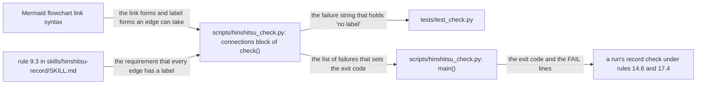

# CONNECTIONS — Mermaid edge forms in the CONNECTIONS.md label check

Form required by rules 7.2 and 9.3 (`skills/hinshitsu-record/SKILL.md`). An edge `A -->|label| B` means B depends on A: a change to A can break B. The label states what B takes from A.

## Graph

## Edge list

| From | To | Label | Broken when |
|---|---|---|---|
| Mermaid flowchart link syntax | `check()` connections block | the link forms and label forms an edge can take | a link form in `evidence/mermaid-flowchart-links.txt` that the CRITERIA name gets the wrong verdict |
| rule 9.3 | `check()` connections block | the requirement that every edge has a label | an edge with no label passes, or an edge with a label fails |
| `check()` connections block | `tests/test_check.py` | the failure string that holds 'no label' | `python3 -m unittest discover -s tests` fails |
| `check()` connections block | `main()` | the list of failures that sets the exit code | the command exits 0 on a folder whose `CONNECTIONS.md` has an unlabeled edge |
| `main()` | a run's record check | the exit code and the FAIL lines | a run with a correct `CONNECTIONS.md` gets exit code 1 from the edge test |

## Nodes outside the DELIVERABLE

| Node | Kind | Version or date checked |
|---|---|---|
| Mermaid flowchart link syntax | document | `mermaid-js/mermaid`, branch `develop`, `packages/mermaid/src/docs/syntax/flowchart.md`, read 2026-11-18 (`evidence/mermaid-flowchart-links.txt`) |
| rule 9.3 | document | `skills/hinshitsu-record/SKILL.md` at commit 93311ab |
