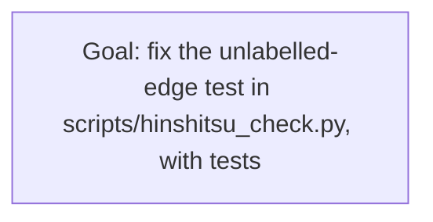

# MINDMAP — Mermaid edge forms in the CONNECTIONS.md label check

Form required by rule 9.2 (`skills/hinshitsu-record/SKILL.md`).

## Hierarchy

- **Goal:** "The checker's test for unlabelled edges in CONNECTIONS.md misses 2 of Mermaid's arrow forms and misreads a third. `A ==> B` and `C -.-> D` pass with no label, and `A -- reads --> B` fails though it has a label. Fix it in `scripts/hinshitsu_check.py`, with tests."

## Diagram

## Node check

| Kind | Count in `AUDIT-LOG.md` | Count in this map |
|---|---|---|
| CRITERIA | 0 | 0 |
| WORK UNITS | 0 | 0 |
| Decisions | 0 | 0 |
| FINDINGS | 0 | 0 |
