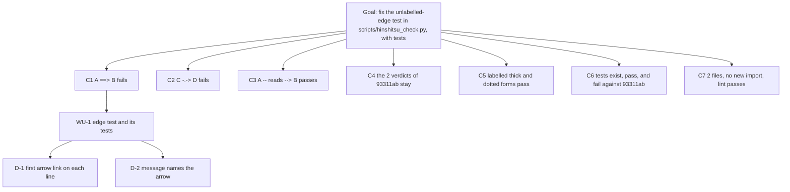

# MINDMAP — Mermaid edge forms in the CONNECTIONS.md label check

Form required by rule 9.2 (`skills/hinshitsu-record/SKILL.md`).

## Hierarchy

- **Goal:** "The checker's test for unlabelled edges in CONNECTIONS.md misses 2 of Mermaid's arrow forms and misreads a third. `A ==> B` and `C -.-> D` pass with no label, and `A -- reads --> B` fails though it has a label. Fix it in `scripts/hinshitsu_check.py`, with tests."
  - **C1** `A ==> B` fails with `no label`
    - **WU-1** the unlabeled-edge test in `scripts/hinshitsu_check.py` and its tests in `tests/test_check.py`
      - **D-1** test the first arrow link on each line; 3 link kinds; 2 label forms
      - **D-2** the failure message names the arrow as written
  - **C2** `C -.-> D` fails with `no label`
  - **C3** `A -- reads --> B` passes
  - **C4** the 2 verdicts of commit 93311ab stay
  - **C5** the 4 labelled thick and dotted forms pass
  - **C6** the tests exist, pass, and fail against commit 93311ab
  - **C7** 2 files changed, no new import, lint passes

## Diagram

## Node check

| Kind | Count in `AUDIT-LOG.md` | Count in this map |
|---|---|---|
| CRITERIA | 7 | 7 |
| WORK UNITS | 1 | 1 |
| Decisions | 2 | 2 |
| FINDINGS | 0 | 0 |
