# MINDMAP — Mermaid edge forms in the CONNECTIONS.md label check

Form required by rule 9.2 (`skills/hinshitsu-record/SKILL.md`).

## Hierarchy

- **Goal:** "The checker's test for unlabelled edges in CONNECTIONS.md misses 2 of Mermaid's arrow forms and misreads a third. `A ==> B` and `C -.-> D` pass with no label, and `A -- reads --> B` fails though it has a label. Fix it in `scripts/hinshitsu_check.py`, with tests."
  - **C1** `A ==> B` fails with `no label`
    - **WU-1** the unlabeled-edge test in `scripts/hinshitsu_check.py` and its tests in `tests/test_check.py`
      - **D-1** test the first arrow link on each line; 3 link kinds; 2 label forms
        - **F-1** DEFECT — a second link on a line, or `--x`, `--o`, counts as the label of a later arrow — FIXED (E-50)
        - **F-2** DEFECT — a label in quotation marks or brackets between the halves of a link fails as no label — FIXED (E-51)
        - **F-3** DEFECT — the second link on a line is not tested, and 1 more unlabeled edge passes — overruled by the USER (E-38)
        - **F-4** FRAGILITY — prose lines and `.->` are read as edges — overruled by the USER (E-56)
      - **D-2** the failure message names the arrow as written
      - **D-3** amend D-1: edges only inside the `mermaid` fence; stricter label test; placeholder for quoted text; bare `.->` is no link
        - **F-5** DEFECT — the second arrow on a line is not tested after a labelled thick, dotted or between-dashes link — overruled by the USER (E-57)
        - **F-6** DEFECT — an earlier dotted link written `.-` counts as the label of a later dotted arrow — overruled by the USER (E-58)
        - **F-7** DEFECT — `--oB`, `--xB`, a flag-shaped node, a `]` inside quoted text and an empty quoted label count as a label — overruled by the USER (E-59)
        - **F-8** FRAGILITY — a second diagram in a `~~~mermaid` or spaced fence is not read — overruled by the USER (E-60)
        - **F-9** STYLE — the message for `A ---> B` now shows the arrow as written — overruled by the USER (E-61)
        - **F-10** DEFECT, BLOCKER under rule 17.4 — the report cites E-24 and E-62 for facts that E-23 and E-26 hold — open
        - **F-11** DEFECT, BLOCKER under rule 17.4 — the report names E-5 as marked late; it is E-3 — open
        - **F-12** DEFECT, BLOCKER under rule 17.4 — check 2 of the report promises the same text; the run's last message is shorter than the saved report — open
        - **F-13** FRAGILITY, BLOCKER under rule 17.4 — 9 output files of E-44 record the command with no quotes — open
        - **F-14** FRAGILITY — `SESSION-STATE.md` line 3 and field 2 were out of date — open
        - **F-15** STYLE — some output files hold no command line or no exit code — open
  - **C2** `C -.-> D` fails with `no label`
  - **C3** `A -- reads --> B` passes
  - **C4** the 2 verdicts of commit 93311ab stay
  - **C5** the 4 labelled thick and dotted forms pass
  - **C6** the tests exist, pass, and fail against commit 93311ab
  - **C7** 2 files changed, no new import, lint passes

## Diagram

```mermaid
graph TD
  G["Goal: fix the unlabelled-edge test in scripts/hinshitsu_check.py, with tests"]
  G --> C1["C1 A ==> B fails"]
  G --> C2["C2 C -.-> D fails"]
  G --> C3["C3 A -- reads --> B passes"]
  G --> C4["C4 the 2 verdicts of 93311ab stay"]
  G --> C5["C5 labelled thick and dotted forms pass"]
  G --> C6["C6 tests exist, pass, and fail against 93311ab"]
  G --> C7["C7 2 files, no new import, lint passes"]
  C1 --> WU1["WU-1 edge test and its tests"]
  WU1 --> D1["D-1 first arrow link on each line"]
  WU1 --> D2["D-2 message names the arrow"]
  WU1 --> D3["D-3 amend D-1: fence, stricter label test"]
  D3 --> F5["F-5 DEFECT: second arrow after a labelled link (overruled by the USER)"]
  D3 --> F6["F-6 DEFECT: dotted earlier link counts as a label (overruled by the USER)"]
  D3 --> F7["F-7 DEFECT: circle end, flag node, bracket in quotes (overruled by the USER)"]
  D3 --> F8["F-8 FRAGILITY: other mermaid fences not read (overruled by the USER)"]
  D3 --> F9["F-9 STYLE: message shows the arrow as written (overruled by the USER)"]
  REC["the run record and DELIVERY-REPORT.md"] --> F10["F-10 report cites the wrong entries (open)"]
  REC --> F11["F-11 report names the wrong late entry (open)"]
  REC --> F12["F-12 check 2 promises the same text (open)"]
  REC --> F13["F-13 saved commands have no quotes (open)"]
  REC --> F14["F-14 session state out of date (open)"]
  REC --> F15["F-15 output files lack command or exit code (open)"]
  D1 --> F1["F-1 DEFECT: earlier link counts as a label (FIXED)"]
  D1 --> F2["F-2 DEFECT: quoted label fails (FIXED)"]
  D1 --> F3["F-3 DEFECT: second link on a line not tested (overruled by the USER)"]
  D1 --> F4["F-4 FRAGILITY: prose lines read as edges (overruled by the USER)"]
```

## Node check

| Kind | Count in `AUDIT-LOG.md` | Count in this map |
|---|---|---|
| CRITERIA | 7 | 7 |
| WORK UNITS | 1 | 1 |
| Decisions | 3 | 3 |
| FINDINGS | 15 | 15 |
