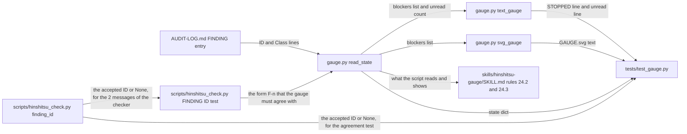

# CONNECTIONS — gauge counts a FINDING whose ID is not F-<n> as unread

An edge `A -->|label| B` means B depends on A. The label states what B takes from A.

## Graph

## Edge list

| From | To | Label | Broken when |
|---|---|---|---|
| AUDIT-LOG.md FINDING entry | gauge.py read_state | ID and Class lines | a FINDING entry in the form of rule 15.1 is not read |
| scripts/hinshitsu_check.py FINDING ID test | gauge.py read_state | the form F-n that the gauge must agree with | the checker accepts an ID that the gauge counts as unread, or refuses one that the gauge lists |
| gauge.py read_state | gauge.py text_gauge | blockers list and unread count | the text gauge prints a count or an ID that `read_state` did not return |
| gauge.py read_state | gauge.py svg_gauge | blockers list | `GAUGE.svg` and the text gauge show different BLOCKERS |
| gauge.py text_gauge | tests/test_gauge.py | STOPPED line and unread line | a test of `tests/test_gauge.py` fails |
| gauge.py svg_gauge | tests/test_gauge.py | GAUGE.svg text | a test of `tests/test_gauge.py` fails |
| gauge.py read_state | tests/test_gauge.py | state dict | a test of `tests/test_gauge.py` fails |
| scripts/hinshitsu_check.py finding_id | scripts/hinshitsu_check.py FINDING ID test | the accepted ID or None, for the 2 messages of the checker | line 310 picks the ID in another way than `finding_id` (F-7) |
| scripts/hinshitsu_check.py finding_id | tests/test_gauge.py | the accepted ID or None, for the agreement test | the checker picks the ID out of the field in another way than `finding_id` does (F-7) |
| gauge.py read_state | skills/hinshitsu-gauge/SKILL.md rules 24.2 and 24.3 | what the script reads and shows | a sentence of rule 24.2 or 24.3 is false of the script (F-5, F-9) |

## Nodes outside the DELIVERABLE

| Node | Kind | Version or date checked |
|---|---|---|
| `AUDIT-LOG.md` FINDING entry | input file that the gauge reads; a file of a RUN FOLDER, not of the DELIVERABLE | form of rule 15.1, commit 1ce96d3 |
| Python 3 standard library | library | version in `evidence/capability-commands.txt` |
| `scripts/hinshitsu_check.py`, other than `finding_id` and lines 306 to 317 | script of this repository; those lines were changed by this run (fix of F-3, commit 894fd4f) | commit 1ce96d3 |
