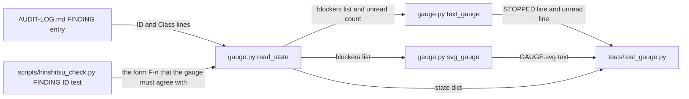

# CONNECTIONS — gauge counts a FINDING whose ID is not F-<n> as unread

An edge `A -->|label| B` means B depends on A. The label states what B takes from A.

## Graph

## Edge list

| From | To | Label | Broken when |
|---|---|---|---|
| AUDIT-LOG.md FINDING entry | gauge.py read_state | ID and Class lines | a FINDING entry in the form of rule 15.1 is not read |
| scripts/hinshitsu_check.py FINDING ID test | gauge.py read_state | the form F-n that the gauge must agree with | the checker accepts an ID that the gauge counts as unread, or refuses one that the gauge lists |
| gauge.py read_state | gauge.py text_gauge | blockers list and unread count | the text gauge prints a count or an ID that `read_state` did not return |
| gauge.py read_state | gauge.py svg_gauge | blockers list | `GAUGE.svg` and the text gauge show different BLOCKERS |
| gauge.py text_gauge | tests/test_gauge.py | STOPPED line and unread line | a test of `tests/test_gauge.py` fails |
| gauge.py svg_gauge | tests/test_gauge.py | GAUGE.svg text | a test of `tests/test_gauge.py` fails |
| gauge.py read_state | tests/test_gauge.py | state dict | a test of `tests/test_gauge.py` fails |

## Nodes outside the DELIVERABLE

| Node | Kind | Version or date checked |
|---|---|---|
| Python 3 standard library | library | version in `evidence/capability-commands.txt` |
| `scripts/hinshitsu_check.py` | script of this repository, not changed by this run | commit a3717b1 |
