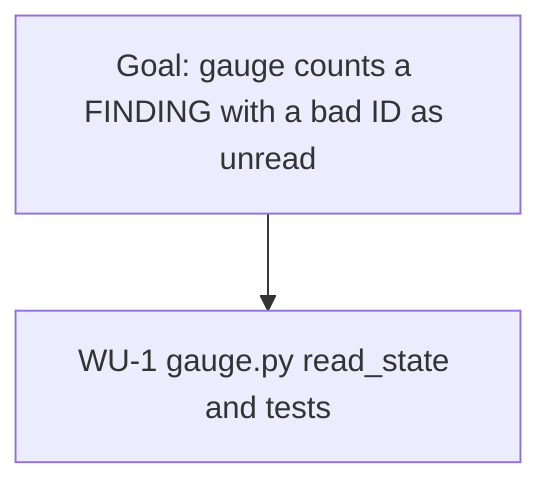

# MINDMAP — gauge counts a FINDING whose ID is not F-<n> as unread

## Hierarchy

- **Goal:** "Make `skills/hinshitsu-gauge/scripts/gauge.py` count such an entry among the entries it could not read, and leave it out of the STOPPED line, with tests."
  - CRITERIA: none written yet
    - **WU-1** `gauge.py` FINDING branch of `read_state`, with tests

## Diagram

## Node check

| Kind | Count in `AUDIT-LOG.md` | Count in this map |
|---|---|---|
| CRITERIA | 0 | 0 |
| WORK UNITS | 1 | 1 |
| Decisions | 0 | 0 |
| FINDINGS | 0 | 0 |

## FINDINGS, from the log

<!-- from the log: start -->
Rebuilt by `scripts/hinshitsu_log.py state`. Do not edit between the marks.
- no FINDING is logged
<!-- from the log: end -->
