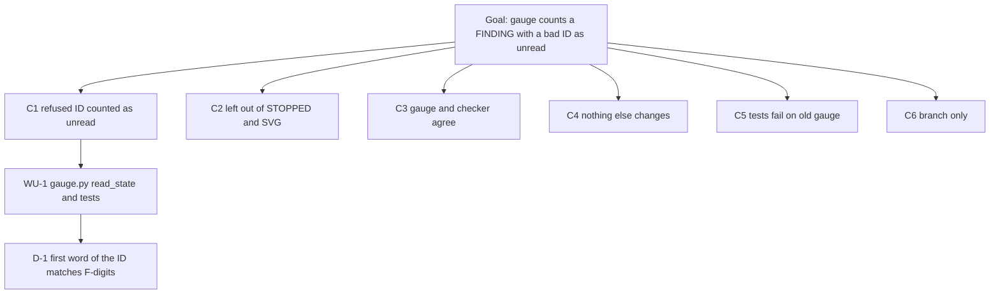

# MINDMAP — gauge counts a FINDING whose ID is not F-<n> as unread

## Hierarchy

- **Goal:** "Make `skills/hinshitsu-gauge/scripts/gauge.py` count such an entry among the entries it could not read, and leave it out of the STOPPED line, with tests."
  - **C1** a FINDING entry with a refused ID is counted as unread
    - **WU-1** `gauge.py` FINDING branch of `read_state`, with tests
      - **D-1** test the first word of the ID field against `F-\d+`, as the checker does
  - **C2** such an entry is left out of the STOPPED line and of `GAUGE.svg` (built in WU-1)
  - **C3** the gauge and the checker agree on the ID (built in WU-1)
  - **C4** nothing else changes (built in WU-1)
  - **C5** new tests that fail on the old `gauge.py` (built in WU-1)
  - **C6** the change is on the branch only (built in WU-1)

## Diagram

## Node check

| Kind | Count in `AUDIT-LOG.md` | Count in this map |
|---|---|---|
| CRITERIA | 6 | 6 |
| WORK UNITS | 1 | 1 |
| Decisions | 1 | 1 |
| FINDINGS | 0 | 0 |

## FINDINGS, from the log

<!-- from the log: start -->
Rebuilt by `scripts/hinshitsu_log.py state`. Do not edit between the marks.
- no FINDING is logged
<!-- from the log: end -->
