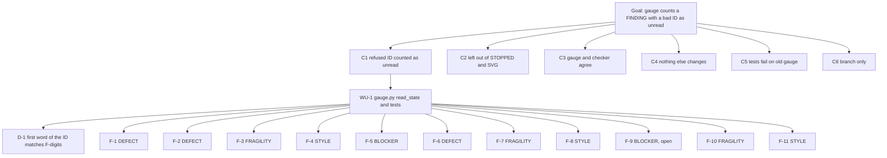

# MINDMAP — gauge counts a FINDING whose ID is not F-<n> as unread

## Hierarchy

- **Goal:** "Make `skills/hinshitsu-gauge/scripts/gauge.py` count such an entry among the entries it could not read, and leave it out of the STOPPED line, with tests."
  - **C1** a FINDING entry with a refused ID is counted as unread
    - **WU-1** `gauge.py` FINDING branch of `read_state`, with tests; `finding_id` in `scripts/hinshitsu_check.py`; rules 24.2 and 24.3 in `skills/hinshitsu-gauge/SKILL.md`
      - **D-1** test the first word of the ID field against `F-\d+`, as the checker does
  - **C2** such an entry is left out of the STOPPED line and of `GAUGE.svg` (built in WU-1)
  - **C3** the gauge and the checker agree on the ID (built in WU-1)
  - **C4** nothing else changes (built in WU-1)
  - **C5** new tests that fail on the old `gauge.py` (built in WU-1)
  - **C6** the change is on the branch only (built in WU-1)

## Diagram

## Node check

| Kind | Count in `AUDIT-LOG.md` | Count in this map |
|---|---|---|
| CRITERIA | 6 | 6 |
| WORK UNITS | 1 | 1 |
| Decisions | 1 | 1 |
| FINDINGS | 11 | 11 (the list is the block "FINDINGS, from the log"; the diagram holds 1 node each) |

## FINDINGS, from the log

<!-- from the log: start -->
Rebuilt by `scripts/hinshitsu_log.py state`. Do not edit between the marks.
- F-1 `skills/hinshitsu-gauge/SKILL.md`, rules 24.2 and 24.3 (lines 15 and 16), against `gauge.py` lines 83 to 89 and `svg_gauge` (lines 153 to 210). (DEFECT, OVERRULED by E-36)
- F-2 `gauge.py` lines 88 to 89 (`fid not in blockers`, `blockers.append(fid)`), against `hinshitsu_check.py` line 302 (`fid = fid.split()[0]`). (DEFECT, OVERRULED by E-37)
- F-3 `gauge.py` line 31 and lines 84 to 85; `tests/test_gauge.py` lines 83 to 92; `scripts/hinshitsu_check.py` lines 85 and 299 to 306. (FRAGILITY, FIXED by E-42)
- F-4 `gauge.py` line 137. (STYLE, OVERRULED by E-38)
- F-5 `skills/hinshitsu-gauge/SKILL.md`, section 24, item 2 and item 3. The commit does not change this file. (BLOCKER, FIXED by E-56)
- F-6 `skills/hinshitsu-gauge/scripts/gauge.py`, `svg_gauge`, lines 153 to 210: no line prints `st["unread"]`. Line 137 prints it in the text gauge only. (DEFECT, OVERRULED by E-51)
- F-7 `scripts/hinshitsu_check.py` line 310 (the only call of `finding_id`) and lines 540 to 541 (`check_record` applies the same test by hand); `tests/test_gauge.py` line 90; `tests/test_check.py` line 467. (FRAGILITY, OVERRULED by E-52)
- F-8 `skills/hinshitsu-gauge/scripts/gauge.py` line 137. (STYLE, OVERRULED by E-47)
- F-9 `skills/hinshitsu-gauge/SKILL.md`, section 24, item 3 (line 16): "shows `STOPPED — blocker open` with the count of open BLOCKERS and the first 4 FINDING IDs". `skills/hinshitsu-gauge/scripts/gauge.py`, lines 88 and 89. (BLOCKER, open)
- F-10 `tests/test_gauge.py`, lines 156 to 159 (`test_svg_is_well_formed_and_escapes`), with `gauge.py` lines 85 to 87 and 144 to 145. (FRAGILITY, OVERRULED by E-63)
- F-11 `skills/hinshitsu-gauge/scripts/gauge.py`, line 137. (STYLE, OVERRULED by E-60)
<!-- from the log: end -->
