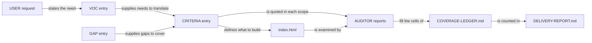

# CONNECTIONS — bill-splitting page

Form: rules 7.2 and 9.3. An edge `A -->|label| B` means B depends on A.

| From | To | Label | Broken when |
|---|---|---|---|
| USER request | VOC entry | states the need | the entry misquotes the request |
| VOC entry | CRITERIA entry | supplies needs to translate | a need has no CRITERION |
| GAP entry | CRITERIA entry | supplies gaps to cover | a gap has no CRITERION and no reason |
| CRITERIA entry | index.html | defines what to build | the page fails a CRITERION |
| CRITERIA entry | AUDITOR reports | is quoted in each scope | a scope words a CRITERION differently |
| index.html | AUDITOR reports | is examined by | the page changes after a report |
| AUDITOR reports | COVERAGE-LEDGER.md | fill the cells of | a cell cites no report |
| COVERAGE-LEDGER.md | DELIVERY-REPORT.md | is counted in | the counts differ |
