# CONNECTIONS — bill-splitting page

Form: rules 7.2 and 9.3. An edge `A -->|label| B` means B depends on A.

```mermaid
graph LR
  N1[USER brief] -->|states the need| N2[VOC entry]
  N2[VOC entry] -->|supplies needs to translate| N3[CRITERIA entry]
  N4[GAP entry] -->|supplies gaps to cover| N3[CRITERIA entry]
  N5[ASSUMPTION entry] -->|supplies the premises each decision names| N6[DECISION entries]
  N6[DECISION entries] -->|fix the rules each test checks| N3[CRITERIA entry]
  N7[USER approval] -->|freezes| N3[CRITERIA entry]
  N3[CRITERIA entry] -->|defines what to build| N8[index.html]
  N6[DECISION entries] -->|set the function contract| N8[index.html]
  N3[CRITERIA entry] -->|is quoted in each scope| N9[AUDITOR reports]
  N8[index.html] -->|is examined by, at a stated SHA-256| N9[AUDITOR reports]
  N8[index.html] -->|is copied before each audit round to| N14[review copy]
  N14[review copy] -->|receives 1 planted defect, recorded in| N15[seed report]
  N14[review copy] -->|is examined by the roles the seed report names, in| N9[AUDITOR reports]
  N15[seed report] -->|is compared with the reports in| N16[CHECK entry]
  N16[CHECK entry] -->|voids or admits| N9[AUDITOR reports]
  N17[scopes in prompts/] -->|start| N9[AUDITOR reports]
  N9[AUDITOR reports] -->|must pass before| N18[published page]
  N8[index.html] -->|is served as| N18[published page]
  N9[AUDITOR reports] -->|raise| N10[FINDING entries]
  N10[FINDING entries] -->|require a fix to| N8[index.html]
  N8[index.html] -->|is examined again after each fix by| N11[re-audit reports]
  N11[re-audit reports] -->|close| N10[FINDING entries]
  N9[AUDITOR reports] -->|fill the cells of| N12[COVERAGE-LEDGER.md]
  N12[COVERAGE-LEDGER.md] -->|is counted in| N13[DELIVERY-REPORT.md]
```

| From | To | Label | Broken when |
|---|---|---|---|
| USER brief | VOC entry | states the need | the entry misquotes the brief |
| VOC entry | CRITERIA entry | supplies needs to translate | a need has no CRITERION |
| GAP entry | CRITERIA entry | supplies gaps to cover | a gap has no CRITERION and no reason |
| ASSUMPTION entry | DECISION entries | supplies the premises each decision names | a decision rests on an unlisted PREMISE |
| DECISION entries | CRITERIA entry | fix the rules each test checks | a CRITERION contradicts a decision in force |
| USER approval | CRITERIA entry | freezes | the entry is FROZEN with no quoted approval |
| CRITERIA entry | index.html | defines what to build | the page fails a CRITERION |
| DECISION entries | index.html | set the function contract | the page's fields bypass splitBill |
| CRITERIA entry | AUDITOR reports | is quoted in each scope | a scope words a CRITERION differently |
| index.html | AUDITOR reports | is examined by, at a stated SHA-256 | the file's SHA-256 differs from the scope's |
| index.html | review copy | is copied before each audit round to | the copy differs from the page before the seeder changes it |
| review copy | seed report | receives 1 planted defect, recorded in | the copy differs from the page by more than the seed report states |
| review copy | AUDITOR reports | is examined by the roles the seed report names, in | a named role examines the page and not the copy |
| seed report | CHECK entry | is compared with the reports in | a round has no `CHECK` entry |
| CHECK entry | AUDITOR reports | voids or admits | a report that missed the planted defect fills a ledger cell |
| scopes in prompts/ | AUDITOR reports | start | a saved scope differs from the scope sent |
| AUDITOR reports | published page | must pass before | the page is published with an open BLOCKER |
| index.html | published page | is served as | the served file's SHA-256 differs from the audited one |
| AUDITOR reports | FINDING entries | raise | a finding in a report has no entry |
| FINDING entries | index.html | require a fix to | a FINDING is closed with no change and no report |
| index.html | re-audit reports | is examined again after each fix by | a fix has no re-audit report |
| re-audit reports | FINDING entries | close | a RESOLUTION cites no report |
| AUDITOR reports | COVERAGE-LEDGER.md | fill the cells of | a cell cites no report |
| COVERAGE-LEDGER.md | DELIVERY-REPORT.md | is counted in | the counts differ |
