# MINDMAP — bill-splitting page

Form: rule 9.2. Updated within the WORK UNIT in which a node appears.

- Goal: a real small deliverable that shows the skill set running (V1)
  - Task chosen: a page that splits a restaurant bill, tip added (T1)
    - WU-1 `index.html`, the whole page (built, E-102; audit round 1 reported, E-171)
      - functions: `splitBill`, `plainChar`, `plain`, `readAmount`, `readWhole`, `money`, `payLine`, `showResult`, `update`
      - F-21 The bill field accepts 10 (BLOCKER, WITHDRAWN)
      - F-22 The bill field accepts 10. and shows a result (BLOCKER, WITHDRAWN)
      - F-23 With JavaScript off, the page still says "The split shows be (BLOCKER, FIXED)
      - F-24 With JavaScript off, the page still tells the reader to type (BLOCKER, FIXED)
      - F-25 With JavaScript off, the page still shows the guidance and 3 (DEFECT, FIXED)
      - F-26 With JavaScript off, the page still tells the reader to type (BLOCKER, FIXED)
      - F-27 With JavaScript off, the page still says "The split shows be (STYLE, FIXED)
      - F-28 with JavaScript off, the guidance and the fields still show (STYLE, FIXED)
      - F-29 With JavaScript off, the page still says "The split shows be (BLOCKER, FIXED)
      - F-30 The line about "the extra cent" is false when more than 1 pe (BLOCKER, FIXED)
      - F-31 The result adds a sentence that no CRITERION asks for, and i (DEFECT, FIXED)
      - F-32 The note says "the extra cent" when several people each pay (STYLE, FIXED)
      - F-33 "Your group decides who pays the extra cent." shows when sev (STYLE, FIXED)
      - F-34 The "extra cent" sentence is false when more than 1 person p (BLOCKER, FIXED)
      - F-35 "the extra cent" is false when more than 1 cent is left over (BLOCKER, FIXED)
      - F-36 C2 lists what the page shows and is silent on the rest (STYLE, overruled)
      - F-37 the framework does not record the extra-cent sentence (STYLE, FIXED)
      - F-38 Screen-reader announcements depend on how the result region (FRAGILITY, open)
      - F-39 The live regions are rewritten when nothing changed, and the (FRAGILITY, FIXED)
      - F-40 Every keystroke and every blur rewrites all 3 error regions (FRAGILITY, FIXED)
      - F-41 The result region is filled while it is not exposed to scree (FRAGILITY, open)
      - F-42 Each keystroke in any field writes every error message again (FRAGILITY, FIXED)
      - F-43 A screen reader may not speak the first result, and may repe (FRAGILITY, open)
      - F-44 window.splitBill = splitBill is a hook that no CRITERION a (STYLE, overruled)
      - F-45 window.splitBill = splitBill; is a leftover test hook that (STYLE, overruled)
      - F-46 Line 67 does nothing (STYLE, overruled)
      - F-47 C4: "The message for a comma says to use a dot" names no fie (DEFECT, FIXED)
      - F-48 A comma in the tip or people field gets no "use a dot" messa (STYLE, FIXED)
      - F-49 no WU-1 scope states the SHA-256 of the page (DEFECT, open)
      - F-50 The scope I received does not state the SHA-256 of index.ht (DEFECT, open)
      - F-51 The copy under review is not the file that C1 and C8 name (FRAGILITY, open)
      - F-52 Characters that look right but are not ASCII get a message t (FRAGILITY, open)
      - F-53 inputmode="decimal" can give a phone keypad with a comma k (FRAGILITY, FIXED)
      - F-54 The submit handler, novalidate and the form-level autoc (STYLE, overruled)
      - F-55 The bill limit is written in 4 places; only 1 is the named c (FRAGILITY, open)
      - F-56 The CSS rule #result[hidden] { display: none; } does nothi (STYLE, overruled)
      - F-57 id="guide" is never used (STYLE, overruled)
      - F-58 The comment above splitBill claims more than is true (STYLE, overruled)
      - F-59 4 names or wrappers do not say what the thing is (STYLE, overruled)
      - F-60 The guidance shows as 2 lines at all 3 widths (STYLE, overruled)
      - F-61 Showing an error moves the content below it (STYLE, overruled)
      - F-62 The 3 fields are required, and the markup does not say so (STYLE, overruled)
      - F-63 An error appears while a person is still typing a valid amou (STYLE, overruled)
      - F-64 the framework and the session state lag behind the built page (DEFECT, open)
      - F-65 the TIER was not measured again after the build (DEFECT, open)
      - F-66 the review copy is not in the framework or the graph (DEFECT, open)
      - F-67 E-84 and E-92 name the wrong part of the framework (DEFECT, open)
      - F-68 E-93 calls a card fault a record fault (DEFECT, open)
      - F-69 E-94 calls a second card fault a record fault (DEFECT, open)
      - F-70 The guide says "the tip" for what the field calls "Tip perce (DEFECT, open)
      - F-71 The bill's error message does not match the rule it enforces (DEFECT, open)
      - F-72 "Bill total" and "Total" are 2 amounts with nearly 1 name; " (STYLE, overruled)
      - F-73 C4: "The page has 3 states" — I observed a 4th (DEFECT, open)
      - F-74 C4: 2 sentences disagree on when an empty field gets its mes (DEFECT, open)
      - F-75 C2: "as read" has 2 meanings (DEFECT, open)
      - F-76 C2: "a whole-number tip from 0 to 100 percent and 1 to 100 p (STYLE, overruled)
      - F-77 Terms in E-98 that a third party cannot test as written (STYLE, overruled)
      - F-78 C8: "3 checks that a reader can do in 5 minutes", and "a rea (DEFECT, open)
      - F-79 E-25's table and the CRITERIA it points to do not say the sa (STYLE, overruled)
      - F-80 E-25 and E-98 use names the glossary does not hold (STYLE, overruled)
      - F-81 The page rejects a bill of exactly 1000000.00, round 2 (BLOCKER, WITHDRAWN)
      - F-82 A bill of exactly 1000000.00 gets an error, round 2 (BLOCKER, WITHDRAWN)
      - F-83 the page reads characters that are not digits as digits, a, round 2 (BLOCKER, FIXED)
      - F-84 The page accepts characters that are not plain, full-width, round 2 (BLOCKER, FIXED)
      - F-85 Characters that are neither full-width nor Arabic-Indic ar, round 2 (BLOCKER, FIXED)
      - F-86 plain accepts characters that C4 does not allow, round 2 (BLOCKER, FIXED)
      - F-87 normalize("NFKC") accepts characters that are not full-wid, round 2 (BLOCKER, FIXED)
      - F-88 Characters that are neither full-width nor Arabic-Indic co, round 2 (BLOCKER, FIXED)
      - F-89 finding 1 of the framework-drift report, round 2 (BLOCKER, FIXED)
      - F-90 "digits" is not defined; the page accepts characters that, round 2 (BLOCKER, open)
      - F-91 "invisible characters at either end are ignored" is false, round 2 (BLOCKER, FIXED)
      - F-92 Invisible characters at the ends of a value are not all ig, round 2 (BLOCKER, FIXED)
      - F-93 Invisible characters at the ends of a value are not ignore, round 2 (BLOCKER, FIXED)
      - F-94 Some invisible characters at the ends are not ignored, round 2 (BLOCKER, FIXED)
      - F-95 Invisible characters at an end of a value are not all igno, round 2 (BLOCKER, FIXED)
      - F-96 An invisible character at either end of a value gets a mes, round 2 (BLOCKER, FIXED)
      - F-97 finding 2 of the framework-drift report, round 2 (BLOCKER, FIXED)
      - F-98 "invisible characters" has no list; the page ignores some, round 2 (BLOCKER, open)
      - F-99 A bill of 12. shows its message while the bill field has t, round 2 (BLOCKER, FIXED)
      - F-100 The bill's message stays while the cursor is in the bill f, round 2 (BLOCKER, FIXED)
      - F-101 The message for 12. stays when the cursor returns to the b, round 2 (BLOCKER, FIXED)
      - F-102 The comment on line 67 does not match C3, round 2 (BLOCKER, open)
      - F-103 finding 3 of the framework-drift report, round 2 (BLOCKER, open)
      - F-104 A comment in the DELIVERABLE cites a file the RECIPIENT do, round 2 (STYLE, overruled)
      - F-105 The script puts 14 names on window; the contract names 1, round 2 (FRAGILITY, FIXED)
      - F-106 13 internal names are global, round 2 (STYLE, FIXED)
      - F-107 finding 11 of the framework-drift report, round 2 (STYLE, FIXED)
      - F-108 FRAMEWORK.md says 3 states; C4 says 4, round 2 (DEFECT, open)
      - F-109 finding 8 of the framework-drift report, round 2 (DEFECT, open)
      - F-110 A window switch puts a message on an empty field that the, round 2 (DEFECT, FIXED)
      - F-111 A long run of spaces inside a value freezes the page, round 2 (FRAGILITY, FIXED)
      - F-112 Five things are written twice, round 2 (STYLE, overruled)
      - F-113 A name and a comment say "typing"; the code tests "has the, round 2 (STYLE, overruled)
      - F-114 Hardcoded values that repeat or sit apart from their const, round 2 (STYLE, overruled)
      - F-115 aria-live="polite" repeats what role="status" already me, round 2 (STYLE, overruled)
      - F-116 finding 4 of the framework-drift report, round 2 (DEFECT, open)
      - F-117 finding 5 of the framework-drift report, round 2 (DEFECT, open)
      - F-118 finding 6 of the framework-drift report, round 2 (DEFECT, open)
      - F-119 finding 7 of the framework-drift report, round 2 (DEFECT, open)
      - F-120 finding 9 of the framework-drift report, round 2 (DEFECT, open)
      - F-121 finding 10 of the framework-drift report, round 2 (STYLE, overruled)
      - F-122 The 4 states overlap, and a fifth state exists, round 2 (DEFECT, open)
      - F-123 "has the cursor" and "leaves" each read 2 ways, round 2 (DEFECT, open)
      - F-124 "Under 2 lines" reads 3 ways, round 2 (DEFECT, open)
      - F-125 "The result shows no other text", yet C2 names no label, round 2 (DEFECT, open)
      - F-126 "each as a number without leading zeros" has an unclear re, round 2 (DEFECT, open)
      - F-127 The rounding rule covers half a cent only, round 2 (DEFECT, open)
      - F-128 1 thing with 2 names, and 1 name for 2 things, round 2 (DEFECT, open)
      - F-129 Tests that name no actor, no input, or no pass condition, round 2 (DEFECT, open)
      - F-130 Statements wider than their tests, round 2 (DEFECT, open)
      - F-131 C6 says "a sentence"; the page shows 2, round 2 (DEFECT, open)
      - F-132 C8: "the last audit round" and "what to open", round 2 (DEFECT, open)
      - F-133 E-25 is out of step with E-175, round 2 (DEFECT, open)
      - F-134 The bill's format message uses a term the page never expla, round 2 (STYLE, overruled)
      - F-135 "Type" and "Enter"; "Number of people", round 2 (STYLE, overruled)
      - F-136 E-175 cites G1 to G13 and gives no place to find them, round 2 (STYLE, overruled)
      - F-137 the card's sentence "removes nothing you asked for" is fal, round 2 (BLOCKER, open)
      - F-138 D-9 states its own cost wrongly, round 2 (BLOCKER, open)
      - F-139 A bill with 1 decimal digit is read as hundredths (seeded), round 3 (BLOCKER, WITHDRAWN)
      - F-140 A bill with 1 decimal digit is read as hundredths: 12.5 , round 3 (BLOCKER, WITHDRAWN)
      - F-141 Visible format characters at an end are ignored, round 3 (BLOCKER, open)
      - F-142 Visible characters at an end are ignored, and the result s, round 3 (DEFECT, open)
      - F-143 maxlength cuts a paste and the page computes on the cut te, round 3 (DEFECT, open)
      - F-144 maxlength="64" cuts a paste without notice and the page , round 3 (FRAGILITY, open)
      - F-145 A browser that refuses the script shows only the heading, round 3 (FRAGILITY, open)
      - F-146 When the script does not run and scripting is on, the page, round 3 (FRAGILITY, open)
      - F-147 The bill message does not name the decimal rule, round 3 (STYLE, overruled)
      - F-148 The bill message does not name the decimal rule, round 3 (STYLE, overruled)
      - F-149 Invisible control characters at an end are not ignored, round 3 (BLOCKER, open)
      - F-150 With U+202E in front, the field shows 12.50 and the page c, round 3 (DEFECT, open)
      - F-151 The README links to EXAMPLE.md, which did not exist, S8 (DEFECT, open)
      - F-152 The README has no step to download and open the page, S8 (DEFECT, open)
      - F-153 The delivered file matches neither the copy the AUDITORS r, S9 (BLOCKER, open)
      - F-154 The USER's instruction to stop has no entry that quotes it, S9 (BLOCKER, open)
      - F-155 The page is not published; a link to the file shows source, S9 (BLOCKER, open)
      - F-156 The overrules of the window.splitBill FINDINGS rest on a false statement, S9 (BLOCKER, open)
      - F-157 9 wording FINDINGS are closed and also promised to the USE, S9 (BLOCKER, open)
      - F-158 The stock reason of 17 overrules is false for 2 and unwritten for 15, S9 (BLOCKER, open)
      - F-159 EXAMPLE.md did not exist at the commit under review, and, S9 (BLOCKER, open)
      - F-160 The delivery-stage checker printed 3 failures on the draft, S10 (DEFECT, open)
      - F-161 The maps name 2 and 1 of the page's 9 functions, and a publi, S10 (DEFECT, open)
      - F-162 The mind map says  has 3 states, S10 (DEFECT, open)
      - F-163 says 1 last audit round ran; 2 ran after the USER's message, S10 (DEFECT, open)
      - F-164 On branch main the README links to EXAMPLE.md, which is abse, S10 (DEFECT, open)
      - F-165 Cited paths use 3 different base folders, S10 (STYLE, open)
    - C1 1 file, works from disk
      - D-8 1 file, policy tag, GitHub Pages approved by the USER, not turned on
        - D-6 superseded
          - D-3 superseded
    - C2 tip, total and payments shown; half a cent rounds up
      - D-4 even split, whole-number tip
        - D-9 a dot or a comma is the decimal mark (supersedes the dot-only part of D-4)
        - D-1 superseded
      - D-5 `splitBill`, half-up rounding, digits to cents
        - D-2 superseded
      - F-3 tip rounding had no rule (BLOCKER, FIXED)
    - C3 payments sum to the total; tested through the page's own fields
      - F-5 the test ran a function, not the page (BLOCKER, FIXED)
      - F-11 a spot case was written with a comma (STYLE, FIXED)
    - C4 4 states; what counts as an amount and as a whole number
      - F-4 `12,50` had no defined result (BLOCKER, FIXED)
      - F-10 no text rule for a whole number (DEFECT, FIXED)
    - C5 3 widths, labels, announced regions, keypad hints
    - C6 sentence when JavaScript is off
    - C7 stores nothing, sends nothing; policy tag
      - F-2 no answer to how a phone gets the page (BLOCKER, FIXED)
  - C8 3 browser-only checks; SHA-256 of the page
    - D-7 the report opens with 3 checks
    - F-1 the request was called the USER's words (BLOCKER, FIXED)
  - Record
    - F-6 2 PREMISES were checkable and left unchecked (BLOCKER, FIXED)
    - F-7 state files were behind the log (BLOCKER, FIXED)
    - F-8 a PREMISE cited EVIDENCE it did not have (DEFECT, FIXED)
    - F-9 2 evidence files held no command (DEFECT, FIXED)
    - F-12 gaps called answered with no answer (DEFECT, FIXED)
    - F-13 the session state left out 2 evidence files (DEFECT, FIXED)
    - F-14 a saved scope differed from the scope sent (DEFECT, FIXED)
    - F-15 an entry named a commit that does not exist (BLOCKER, FIXED)
    - F-16 a card lacked 1 of 3 required choices (DEFECT, FIXED)
    - F-17 a reversal had no entry of that type (DEFECT, FIXED)
    - F-18 2 files named a closed FINDING as open (BLOCKER when raised, DEFECT under rule 14.6; FIXED)
    - F-19 a card offered an exit the rules do not allow (DEFECT, FIXED)
    - F-20 a card ran over 120 words (STYLE, overruled)

```mermaid
graph TD
  GOAL[Goal: a real small deliverable that shows the skill set running] --> T1[Task: bill-splitting page]
  GOAL --> C8[C8 browser-only checks]
  T1 --> C1[C1 one file]
  T1 --> C2[C2 tip, total, payments]
  T1 --> C3[C3 payments sum to total]
  T1 --> C4[C4 three states, input rules]
  T1 --> C5[C5 widths, labels, keypad]
  T1 --> C6[C6 no-JavaScript sentence]
  T1 --> C7[C7 stores and sends nothing]
  C1 --> D8[D-8 one file, policy tag, Pages approved, not turned on]
  C7 --> D8
  C2 --> D4[D-4 even split, whole-number tip]
  C4 --> D9[D-9 dot or comma as decimal mark]
  C2 --> D5[D-5 splitBill, half-up, digits to cents]
  C3 --> D5
  C4 --> D5
  C8 --> D7[D-7 report opens with 3 checks]
  C8 --> F1[F-1 BLOCKER]
  C7 --> F2[F-2 BLOCKER]
  C2 --> F3[F-3 BLOCKER]
  C4 --> F4[F-4 BLOCKER]
  C3 --> F5[F-5 BLOCKER]
  GOAL --> REC[Record]
  REC --> F6[F-6 BLOCKER]
  REC --> F7[F-7 BLOCKER]
  REC --> F8[F-8 DEFECT]
  REC --> F9[F-9 DEFECT]
  REC --> F12[F-12 DEFECT]
  REC --> F13[F-13 DEFECT]
  C4 --> F10[F-10 DEFECT]
  C3 --> F11[F-11 STYLE]
  T1 --> WU1[WU-1 index.html]
  D4 --> D1[D-1 superseded]
  D5 --> D2[D-2 superseded]
  D8 --> D6[D-6 superseded]
  D6 --> D3[D-3 superseded]
  REC --> F14[F-14 DEFECT]
  REC --> F15[F-15 BLOCKER]
  REC --> F16[F-16 DEFECT]
  REC --> F17[F-17 DEFECT]
  REC --> F18[F-18 BLOCKER]
  REC --> F19[F-19 DEFECT]
  REC --> F20[F-20 STYLE]
  T1 --> WU1[WU-1 index.html]
  C4 --> F21[F-21 BLOCKER]
  C4 --> F22[F-22 BLOCKER]
  C6 --> F23[F-23 BLOCKER]
  C6 --> F24[F-24 BLOCKER]
  C6 --> F25[F-25 DEFECT]
  C6 --> F26[F-26 BLOCKER]
  C6 --> F27[F-27 STYLE]
  C6 --> F28[F-28 STYLE]
  C6 --> F29[F-29 BLOCKER]
  C2 --> F30[F-30 BLOCKER]
  C2 --> F31[F-31 DEFECT]
  C2 --> F32[F-32 STYLE]
  C2 --> F33[F-33 STYLE]
  C2 --> F34[F-34 BLOCKER]
  C2 --> F35[F-35 BLOCKER]
  C2 --> F36[F-36 STYLE]
  C2 --> F37[F-37 STYLE]
  C5 --> F38[F-38 FRAGILITY]
  C5 --> F39[F-39 FRAGILITY]
  C5 --> F40[F-40 FRAGILITY]
  C5 --> F41[F-41 FRAGILITY]
  C5 --> F42[F-42 FRAGILITY]
  C5 --> F43[F-43 FRAGILITY]
  C3 --> F44[F-44 STYLE]
  C3 --> F45[F-45 STYLE]
  C3 --> F46[F-46 STYLE]
  C4 --> F47[F-47 DEFECT]
  C4 --> F48[F-48 STYLE]
  C8 --> F49[F-49 DEFECT]
  C8 --> F50[F-50 DEFECT]
  REC --> F51[F-51 FRAGILITY]
  WU1 --> F52[F-52 FRAGILITY]
  WU1 --> F53[F-53 FRAGILITY]
  WU1 --> F54[F-54 STYLE]
  WU1 --> F55[F-55 FRAGILITY]
  WU1 --> F56[F-56 STYLE]
  WU1 --> F57[F-57 STYLE]
  WU1 --> F58[F-58 STYLE]
  WU1 --> F59[F-59 STYLE]
  WU1 --> F60[F-60 STYLE]
  WU1 --> F61[F-61 STYLE]
  WU1 --> F62[F-62 STYLE]
  WU1 --> F63[F-63 STYLE]
  REC --> F64[F-64 DEFECT]
  REC --> F65[F-65 DEFECT]
  REC --> F66[F-66 DEFECT]
  REC --> F67[F-67 DEFECT]
  REC --> F68[F-68 DEFECT]
  REC --> F69[F-69 DEFECT]
  WU1 --> F70[F-70 DEFECT]
  WU1 --> F71[F-71 DEFECT]
  WU1 --> F72[F-72 STYLE]
  WU1 --> F73[F-73 DEFECT]
  WU1 --> F74[F-74 DEFECT]
  WU1 --> F75[F-75 DEFECT]
  WU1 --> F76[F-76 STYLE]
  WU1 --> F77[F-77 STYLE]
  REC --> F78[F-78 DEFECT]
  REC --> F79[F-79 STYLE]
  REC --> F80[F-80 STYLE]
```

