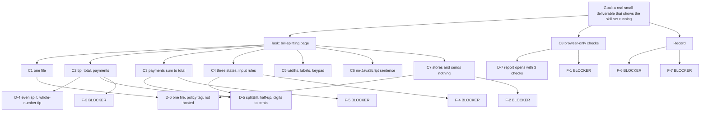

# MINDMAP — bill-splitting page

Form: rule 9.2. Updated within the WORK UNIT in which a node appears.

- Goal: a real small deliverable that shows the skill set running (V1)
  - Task chosen: a page that splits a restaurant bill, tip added (T1)
    - C1 1 file, works from disk — D-6
    - C2 tip, total and payments shown; half a cent rounds up — D-4, D-5
      - F-3 tip rounding had no rule (BLOCKER, fix awaits re-audit)
    - C3 payments sum to the total; tested through the page's own fields — D-5
      - F-5 the test ran a function, not the page (BLOCKER, fix awaits re-audit)
    - C4 3 states; what counts as an amount — D-5
      - F-4 `12,50` had no defined result (BLOCKER, fix awaits re-audit)
    - C5 3 widths, labels, announced regions, keypad hints
    - C6 sentence when JavaScript is off
    - C7 stores nothing, sends nothing; policy tag — D-6
      - F-2 no answer to how a phone gets the page (BLOCKER, fix awaits re-audit)
  - C8 3 browser-only checks; SHA-256 of the page — D-7
    - F-1 the request was called the USER's words (BLOCKER, fix awaits re-audit)
  - Record
    - F-6 A-3 and A-4 were checkable and left unchecked (BLOCKER, fix awaits re-audit)
    - F-7 state files were behind the log (BLOCKER, fix awaits re-audit)

