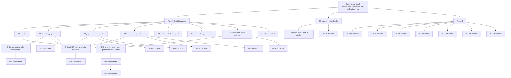

# MINDMAP — bill-splitting page

Form: rule 9.2. Updated within the WORK UNIT in which a node appears.

- Goal: a real small deliverable that shows the skill set running (V1)
  - Task chosen: a page that splits a restaurant bill, tip added (T1)
    - WU-1 `index.html`, the whole page (not started)
    - C1 1 file, works from disk
      - D-8 1 file, policy tag, published with GitHub Pages after its audits
        - D-6 superseded
          - D-3 superseded
    - C2 tip, total and payments shown; half a cent rounds up
      - D-4 even split, whole-number tip
        - D-1 superseded
      - D-5 `splitBill`, half-up rounding, digits to cents
        - D-2 superseded
      - F-3 tip rounding had no rule (BLOCKER, FIXED)
    - C3 payments sum to the total; tested through the page's own fields
      - F-5 the test ran a function, not the page (BLOCKER, FIXED)
      - F-11 a spot case was written with a comma (STYLE, FIXED)
    - C4 3 states; what counts as an amount and as a whole number
      - F-4 `12,50` had no defined result (BLOCKER, FIXED)
      - F-10 no text rule for a whole number (DEFECT, FIXED)
    - C5 3 widths, labels, announced regions, keypad hints
    - C6 sentence when JavaScript is off
    - C7 stores nothing, sends nothing; policy tag
      - F-2 no answer to how a phone gets the page (BLOCKER, FIXED)
  - C8 3 browser-only checks; SHA-256 of the page
    - D-7 the report opens with 3 checks
    - F-1 the request was called the USER's words (BLOCKER, FIXED)
  - Record
    - F-6 2 PREMISES were checkable and left unchecked (BLOCKER, FIXED)
    - F-7 state files were behind the log (BLOCKER, open after 3 rounds; fourth fix made, not re-audited)
    - F-8 a PREMISE cited EVIDENCE it did not have (DEFECT, FIXED)
    - F-9 2 evidence files held no command (DEFECT, FIXED)
    - F-12 gaps called answered with no answer (DEFECT, FIXED)
    - F-13 the session state left out 2 evidence files (DEFECT, FIXED)
    - F-14 a saved scope differed from the scope sent (DEFECT, open)

