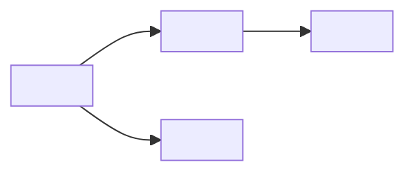

# CONNECTIONS — <task name>

Form required by rules 7.2 and 9.3 (`skills/hinshitsu-record/SKILL.md`). Copy this file into the RUN FOLDER at the start of the run.

An edge `A -->|label| B` means B depends on A: a change to A can break B. The label states what B takes from A. An edge with no label is a FINDING. Before changing a node, write a `TRACE` entry (rule 7.6): forward (each node the changed node points to), backward (each assumption and decision it rests on), lateral (each WORK UNIT that shares a provider with it).

## Graph

## Edge list

| From | To | Label | Broken when |
|---|---|---|---|
| <provider> | <consumer> | <what the consumer takes> | <the observable condition that shows the edge is broken> |

Every edge in the graph has 1 row here, and every row has an edge. A broken edge triggers a RED CELL probe (rule 6.3(c)).

## Nodes outside the DELIVERABLE

| Node | Kind | Version or date checked |
|---|---|---|
| <dependency, service, document or data source> | <library | API | document | data> | <version or date> |
