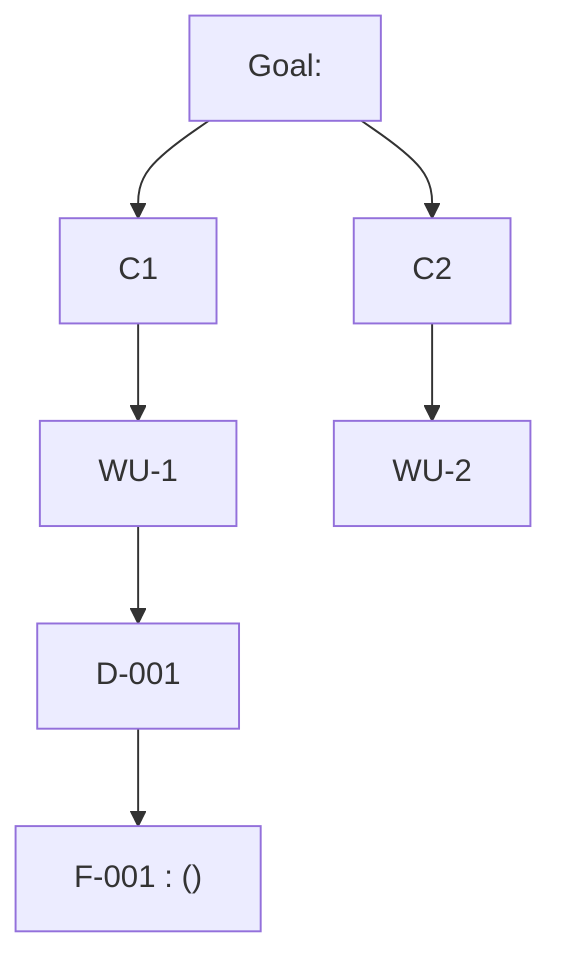

# MINDMAP — <task name>

Form required by rule 9.2 (`skills/hinshitsu-record/SKILL.md`). Copy this file into the RUN FOLDER, replace every `<…>`, and update it within the WORK UNIT in which a node appears. Every CRITERION, WORK UNIT, decision and FINDING appears once, in both the list and the diagram. A node with no parent is a FINDING.

## Hierarchy

- **Goal:** <the USER's goal, in the USER's words>
  - **C1** <criterion text>
    - **WU-1** <component>
      - **D-001** <decision>
        - **F-001** <class> — <finding, 1 line> — <FIXED | WITHDRAWN | OVERRULED | open>
  - **C2** <criterion text>
    - **WU-2** <component>

## Diagram

## Node check

| Kind | Count in `AUDIT-LOG.md` | Count in this map |
|---|---|---|
| CRITERIA | <n> | <n> |
| WORK UNITS | <n> | <n> |
| Decisions | <n> | <n> |
| FINDINGS | <n> | <n> |

The 2 counts in each row are equal at delivery. A difference is a FINDING.
